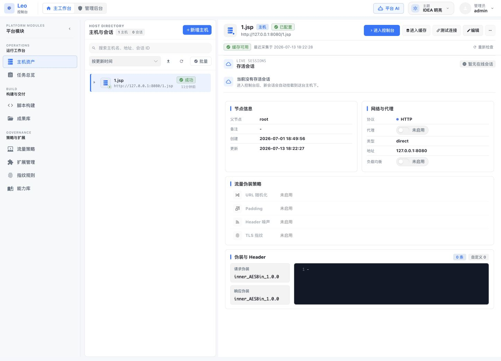
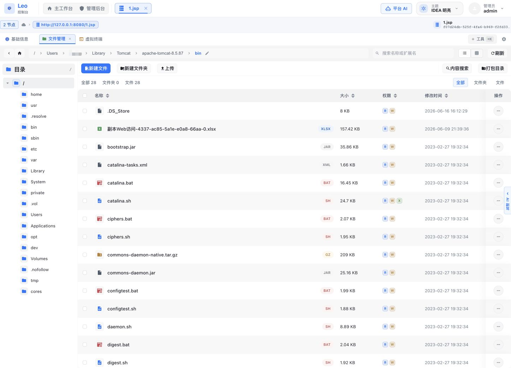
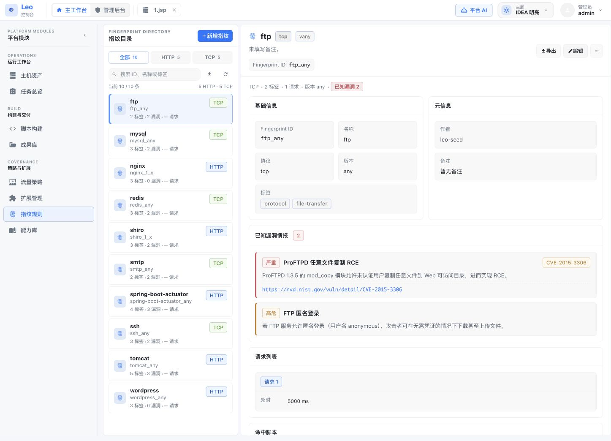

[English](README_EN.md) | **中文**


# LeoAI

[](LICENSE)
[](https://openjdk.org/)
[](https://www.php.net/)
[](https://spring.io/projects/spring-boot)
[](https://github.com/langchain4j/langchain4j)

LeoAI 是一个用于主机管理、项目协作和团队管理的 Web 工作台。



*主工作台：集中查看主机目录、在线会话和主机详情。*

## 目录

- [主要功能](#主要功能)
- [界面预览](#界面预览)
- [技术栈](#技术栈)
- [环境要求](#环境要求)
- [快速开始](#快速开始)
- [源码构建与验证](#源码构建与验证)
- [配置说明](#配置说明)
- [使用指南](#使用指南)
- [接入节点与会话术语](docs/agent-terminology.md)
- [常见问题](#常见问题)
- [安全建议](#安全建议)
- [License](#license)

## 主要功能

- **主机与项目**：按项目整理主机，查看已有会话，管理项目资料和归档状态。
- **AI 助手**：在工作台发起任务，查看进度和结果。使用前可在「管理后台 → AI 模型接入」配置模型。
- **团队管理**：在管理后台管理用户、团队和权限，查询审计记录。

### 管理功能

| 功能 | 描述 |
|------|------|
| **用户管理** | 创建用户、角色分配、权限控制 |
| **团队管理** | 创建团队、成员邀请、节点共享 |
| **AI 配置** | 多 LLM 通道配置、模型切换、API Key 管理 |
| **审计日志** | 操作审计（命令执行、文件操作等）、AI 对话审计 |
| **会话管理** | 会话记录、结果导出、操作报告生成 |

删除账号前需先交接其负责的团队和项目（含已归档项目）。管理员可用 `POST /platform/projects/transfer`，请求字段为 `projectId` 和 `newOwnerUserId`。接任账号须已启用；交接只变更负责人，原共享范围和归档状态保持原样。

项目管理者可通过 `POST /platform/projects/archive` 归档，或通过 `POST /platform/projects/restore` 恢复。两个接口均只接收 `projectId`，只更新项目状态和更新时间，不保存其他项目资料的草稿。

`POST /platform/projects/update` 未传 `status` 时保留数据库中的当前状态；仍支持显式提交 `active` 或 `archived`。项目设置中的普通保存不会提交状态。

团队审计统计使用日志写入时记录的团队归属；成员调组或删除账号、团队都不会改变已记录的归属。清理旧日志按应用本地时间计算，与记录时间一致。

## 界面预览

以下为原有界面截图，部分菜单名称或布局与当前版本有所不同。

### AI 助手


*在同一界面切换对话、选择模型，查看任务进度与结果。*

### 文件管理



*通过目录树和面包屑浏览文件，可按类型筛选并查看文件属性。*

### 管理后台


*管理用户和团队、配置 AI 模型，并查看审计记录和操作趋势。*

### 扩展管理


*从扩展目录浏览已安装的项目，查看说明与参数，管理导入和导出。*

### 指纹规则



*在规则目录中搜索和筛选条目，查看标签、说明及关联资料。*

### 能力库


*按类别浏览能力，查看适用范围及关联文件。*

### 其他页面

- **操作控制台**：在当前会话中查看主机概况，并通过标签切换功能。
- **脚本构建**：集中展示模板选项、表单和预览区域。
- **流量策略**：提供模板目录和请求、响应的预览界面。

## 技术栈

| 层级 | 技术选型 |
|------|--------|
| **Web 框架** | Spring Boot 3.5.13 |
| **前端** | Vue 3、Vite |
| **AI 框架** | LangChain4j 1.23.0 |
| **LLM 接口** | Chat Completions / Responses；可用功能取决于供应商和模型 |
| **数据库** | SQLite（内嵌，无需额外部署）|
| **ORM** | MyBatis 3 |
| **HTTP 客户端** | OkHttp 4 |
| **字节码操作** | Javassist 3.30 |
| **构建工具** | Maven（多模块）|
| **平台运行环境** | Java 17+ |
| **Agent Runtime** | Java Component、PHP 5.6+ Component |

---

## 环境要求

| 项目 | 要求 |
|------|------|
| **Java 版本** | 17 或更高（JDK/JRE 均可） |
| **操作系统** | Linux、macOS、Windows |
| **内存** | 建议 4 GB 以上 |
| **磁盘** | 至少 500 MB 可用空间 |
| **浏览器** | Chrome、Firefox、Edge 等现代浏览器 |
| **PHP Agent** | 目标环境 PHP 5.6+；按所用能力安装 PDO/ZipArchive 等扩展 |

> 无需单独安装数据库：内置 SQLite，首次启动自动初始化。
>
> 无需额外部署前端：Web 界面已打包至 JAR 文件中。

---

## 快速开始

### 第一步：获取 JAR

> 当前版本按全新部署验证。使用新的运行目录或 SQLite 路径启动，系统直接创建当前表结构，不执行旧库补列或迁移。
>
> 历史数据库、旧配置包及旧会话缓存不兼容。重新部署前先[备份数据与密钥](#备份与恢复)，同步部署当前前后端，并重新创建节点配置；节点脚本、引用旧 Java 包名的插件及缓存制品需要重新构建。回滚时同时恢复旧版本和对应数据目录。
>
> Docker 部署请使用新的持久化数据卷或数据目录。仅重启、重新构建容器仍会复用旧数据卷，不会重建数据库。

若 [Releases](https://github.com/cha0upup/LeoAI/releases) 已提供对应版本，可直接下载 JAR。尚无对应制品时，请参照[源码构建与验证](#源码构建与验证)。下文以 `LeoAi-3.0.1.jar` 为例。

### 第二步：启动

新库预置系统默认配置和内置模型能力目录，不预置账号或密码。首次访问 Web 页面时，由初始化向导创建管理员及内置团队。使用当前结构且已有账号的部署保持原登录流程和凭据。

```bash
java --add-opens java.base/java.lang=ALL-UNNAMED -jar LeoAi-3.0.1.jar
```

> `--add-opens java.base/java.lang=ALL-UNNAMED` 参数**不可省略**，用于开放 Java 模块系统内部访问权限。

### 第三步：访问

浏览器打开：

```
http://localhost:8082
```

### 第四步：初始化

首次启动时，系统自动完成以下操作：

1. 初始化 SQLite 数据库（在运行目录下生成 `data.db`）
2. 初始化 VFS、内置资源及基础配置；重启时保留当前配置值
3. 通过 Web 初始化页面设置管理员密码，并创建管理员及其团队

**管理员账号**：`admin`。首次访问时输入密码并确认，完成后使用该密码登录，无需再次强制改密。初始化入口随即永久关闭，重启、重命名或删除账号均不会重新开放，也不会覆盖已有密码。完成初始化之前，请限制服务的网络访问；远程部署建议通过 HTTPS 访问。

启动时统一解析 VFS 的绝对路径（空配置使用运行目录下的 `root`），创建根目录并实际验证读写。内置指纹仅补齐缺失文件；内置 Skill 的受管路径按内容同步，内容未变时保留文件时间，自定义 Skill 目录不受影响。资源先写入同目录临时文件，再通过文件系统原子发布，存储需支持原子替换和硬链接。关键资源准备失败会中止启动，不进入就绪状态。

数据库、资源初始化和启动监听器全部完成后才开放 API；准备期间返回 HTTP 503 和 `Retry-After`。页面按有效提示自动检查最多 3 次，之后仍可点击「重新检查」。其他连接异常保留手动检查入口，不会被当作已初始化。初始化已确认或响应丢失时，页面先检查服务端状态，不自动重发初始化表单。来自应用内链接的原始页面会保留到登录完成。

---

### Docker 启动

如果你不想折腾 Java 环境，直接用 Docker 一条命令启动即可。镜像构建时会自动从 Release 页面下载 JAR，不需要在本机装 JDK/Maven，也不会编译源码。

#### 第一步：安装 Docker

| 系统 | 操作 |
|------|------|
| **Windows / macOS** | 下载 [Docker Desktop](https://www.docker.com/products/docker-desktop/) 并安装，启动后保持 Docker 桌面在后台运行 |
| **Linux** | 按 [官方文档](https://docs.docker.com/engine/install/) 安装 docker engine 和 docker compose 插件 |

安装完成后打开终端验证（任意目录均可）：

```bash
docker --version
docker compose version
```

只要能看到版本号即可。

> **提示**：以下命令不需要 `sudo` 时尽量不用。Linux 下若提示 `permission denied`，把当前用户加入 `docker` 组（`sudo usermod -aG docker $USER` 后重新登录），或者命令前加 `sudo`。

#### 第二步：获取项目代码

任选一种方式：

```bash
# 方式 A：使用 git（推荐，便于后续更新）
git clone https://github.com/cha0upup/LeoAI.git
cd LeoAI

# 方式 B：直接下载 ZIP
# 打开 https://github.com/cha0upup/LeoAI 点击 Code → Download ZIP
# 解压后在终端 cd 进解压目录
```

#### 第三步：一键启动

在项目根目录（能看到 `Dockerfile` 和 `docker-compose.yml` 的位置）执行：

```bash
docker compose up -d --build
```

首次部署直接启动容器，再通过 Web 初始化页面设置 admin 密码，无需密码环境变量。

参数说明：
- `up`：启动服务
- `-d`：后台运行（detached），关闭终端不会停止容器
- `--build`：首次启动或代码更新时构建镜像；之后日常启动可省略

首次启动需要拉取基础镜像 + 下载 JAR + 安装运行时依赖，**国内网络通常需要 3~10 分钟**。看到类似下面的输出就成功了：

```text
[+] Running 2/2
 ✔ Network leoai_default     Created
 ✔ Container leoai           Started
```

#### 第四步：访问 Web 界面

浏览器打开：

```text
http://localhost:8082
```

**管理员账号**：`admin`。首次访问会进入初始化页面，设置并确认密码后返回登录页。已有部署直接登录，初始化页面不再开放。

#### 常用命令速查

```bash
# 查看运行状态
docker compose ps

# 查看实时日志（Ctrl+C 退出，容器继续运行）
docker compose logs -f

# 停止服务（保留数据）
docker compose stop

# 重新启动
docker compose start

# 完全停止并删除容器（保留数据 volume）
docker compose down

# 完全清理（含数据，⚠️ 不可恢复）
docker compose down -v

# 升级到最新版本（拉取新代码 + JAR 重新构建）
git pull
docker compose up -d --build
```

#### 数据持久化

Compose 将 `leoai-data` 卷挂载到 `/app/data`。默认数据库、VFS 和本地密钥文件都在这个目录下。重建容器会复用该卷；`docker compose down -v` 会删除该卷。

卷的实际名称通常为 `<Compose 项目名>_leoai-data`，可用 `docker volume ls` 查询。备份时见[备份与恢复](#备份与恢复)。

#### 自定义配置

最简单的做法是在项目根目录新建 `.env` 文件，docker compose 会自动读取：

```bash
# 修改 Web 端口（避开 8082 被占用的情况）
LEOAI_PORT=9090

# 生产环境建议改成强随机字符串（至少 16 位）
LEO_PLUGIN_ENCRYPT_KEY=please-change-me-to-a-strong-key

# 锁定到特定版本的 JAR；默认值以 docker-compose.yml / Dockerfile 为准
# JAR_URL=https://github.com/cha0upup/LeoAI/releases/download/vX.Y.Z/LeoAi-X.Y.Z.jar
```

修改 `.env` 后用 `docker compose up -d` 让改动生效。**注意**：改 `JAR_URL` 必须加 `--build`，否则不会重新拉取。

也可以通过命令行覆盖端口：

```bash
LEOAI_PORT=9090 docker compose up -d
```

#### 常见问题

**端口冲突 `Bind for 0.0.0.0:8082 failed: port is already allocated`**
- 在 `.env` 里改 `LEOAI_PORT=9090`（或任意空闲端口）后重新 `docker compose up -d`

**镜像构建卡在下载 JAR**
- 多半是 GitHub 网络不通。挂代理后重新 `docker compose build`，或先手动把 JAR 下载到本地，改 Dockerfile 的 `JAR_URL` 指向局域网镜像

**忘记 admin 密码**
- 重建数据卷会清除其中的业务数据。先[备份数据与密钥](#备份与恢复)，再通过 Web 初始化页面为新卷设置管理员密码；常规改密使用用户管理。

**查看容器内文件**
- `docker compose exec leoai sh` 进入容器，数据目录在 `/app/data`

---

## 源码构建与验证

在后端仓库根目录使用 **JDK 17** 和仓库自带的 Maven Wrapper 打包：

```bash
./mvnw -pl web -am -DskipTests package
```

制品位于 `web/target/LeoAi-3.0.1.jar`，使用后端仓库已同步的前端静态资源。修改前端源码后，应先构建并同步产物，再验证打包结果。

全量验证需要另行检出匹配的前端源码到 `../LeoVueAi`（或传入实际位置）、按前端 `.nvmrc` 配置 Node.js，并准备 Python 3 和用于组件检查的 JDK 8（可用 `JAVA8_HOME` 指定）。若需运行 PHP 集成用例，还要安装 PHP CLI 和 `pdo_sqlite`。

```bash
python3 tools/verify_release.py --frontend ../LeoVueAi
```

脚本安装前端锁定依赖，运行 lint、测试与构建，校验静态资源一致性，编译打包后端，并用临时数据库验证首次启动、登录和重启。已安装锁定依赖时可加 `--skip-install`。更多说明见[贡献指南](CONTRIBUTING.md)。

---

## 配置说明

### 修改端口

默认端口为 `8082`，通过启动参数修改：

```bash
java --add-opens java.base/java.lang=ALL-UNNAMED -jar \
  LeoAi-3.0.1.jar --server.port=9090
```

### 修改数据库位置

默认数据库文件为运行目录下的 `data.db`：

```bash
java --add-opens java.base/java.lang=ALL-UNNAMED -jar \
  LeoAi-3.0.1.jar \
  --spring.datasource.url=jdbc:sqlite:/path/to/data.db
```

### 备份与恢复

- 默认 SQLite 数据库为运行目录下的 `data.db`，文件工作区（VFS）为 `root/`；改过数据源或 `VfsPath` 时，以实际配置为准。
- SQLite 启用了 WAL。做文件级备份前先停止服务，不要在服务运行时只复制 `data.db`；若停机后仍有 `-wal` 文件，应随数据库文件一并备份。
- 同批备份 VFS 和用于解密已存凭据的本地密钥（默认位于 `.leo/`）；使用外部主密钥时，单独妥善保管原值。恢复时使用同一批次的数据、对应应用版本和原密钥，先在独立目录验证。

### 配置 AI 模型

LeoAI 的 AI 功能从管理后台读取 Provider 与模型配置：

1. 登录后进入「**管理后台 → AI 配置**」
2. 点击「**添加通道**」
3. 填写通道名称、API Key、Base URL、模型名称
4. 点击「**测试连接**」验证后保存

连接地址、协议、API Key 和自定义请求头统一保存于供应商配置，该供应商下的模型继承这些设置，各自保留模型参数和备用模型。

### 支持的 AI 模型

兼容任何遵循 OpenAI API 格式的服务：

| 提供商 | Base URL 示例 |
|--------|-----------|
| OpenAI | `https://api.openai.com/v1` |
| 通义千问（阿里） | `https://dashscope.aliyuncs.com/compatible-mode/v1` |
| DeepSeek | `https://api.deepseek.com` |
| Kimi（Moonshot） | `https://api.moonshot.cn/v1` |
| 智谱（GLM） | `https://open.bigmodel.cn/api/paas/v4` |
| Gemini（OpenAI 兼容） | `https://generativelanguage.googleapis.com/v1beta/openai` |
| 小米 MiMo | `https://api.xiaomimimo.com/v1` |
| OpenRouter | `https://openrouter.ai/api/v1` |
| Ollama（本地） | `http://localhost:11434/v1` |
| 其他兼容接口 | 根据文档填写对应地址 |

Kimi 预设使用 Chat Completions，支持获取模型和手动添加模型。内置能力库收录 K3.1 Pro、K3、K2.7 Code 和 K2.6 系列；系统按模型处理思考参数与固定采样参数。国际站可将 Base URL 调整为 `https://api.moonshot.ai/v1`，并使用对应站点的 API Key。参数约束见 [Kimi 官方文档](https://platform.kimi.com/docs/api/models-overview)。

内置对话能力库于 2026-11-03 核对，共收录 26 个当前型号：OpenAI GPT-6 Astra / GPT-6.1 Sol / GPT-6.1 Terra / GPT-6 Luna、DeepSeek Flash / V4 Pro、Kimi K3.1 / K3 / K2.7 / K2.6、Qwen3.8 Max / Flash 与 Qwen3.7 Plus、GLM-5.3 系列、Gemini 4 Argon / 3.8 Flash / 3.6 Flash / 3.5 Flash-Lite、MiMo V2.6 Pro / Flash / Pro Ultraspeed。能力行的备注保留核对日期与官方来源；音频、图像生成等专用模型不作为聊天模型预置。

选择供应商后可勾选预设候选模型，也可「获取模型」按实际账号或本地部署的返回列表导入。OpenRouter、Ollama 与自定义网关不预置固定型号。模型可用性受地区、账户及服务开通情况影响；Kimi K2 系列目前仅对已有账号开放，MiMo Ultraspeed 需申请定制服务。MiMo V2.5 文本模型已下线，预设已更新为 V2.6；系统不自动改写已保存模型的 ID、API Key 或手工能力覆盖。

Ollama 本地服务不校验 API Key；当前统一配置表单可填写占位值 `ollama`，实际模型以本地已安装列表为准。

思考模式、等级和固定采样约束由后端统一提供，前端只展示对应模型允许的选项。GPT-6 工具调用优先使用 Responses API，输入预算另受 922K 上限约束；Gemini 4 当前采用同步输出上限，不启用 long decode。官方依据：[OpenAI](https://developers.openai.com/api/docs/models)、[DeepSeek](https://api-docs.deepseek.com/quick_start/pricing/)、[Qwen](https://help.aliyun.com/en/model-studio/text-generation-model/)、[GLM](https://docs.bigmodel.cn/cn/guide/start/model-overview)、[Gemini](https://aistudio.google.com/docs/models)、[MiMo](https://mimo.mi.com/docs/zh-CN/quick-start/summary/model)。

### 主要配置项参考

`web/src/main/resources/application.properties`：

```properties
# 服务器端口
server.port=8082

# 数据库（SQLite，路径相对于运行目录）
spring.datasource.url=jdbc:sqlite:data.db

```

---

## 使用指南

### 团队协作

- 在「**管理后台 → 团队管理**」创建团队并邀请成员
- 在节点详情中点击「**分享**」，指定团队或成员及读写权限
- 所有操作记录在「**管理后台 → 审计日志**」，支持按用户/时间/类型筛选

## 常见问题

**Q：启动时报 `InaccessibleObjectException`**

必须添加 `--add-opens` 参数，不可省略：

```bash
java --add-opens java.base/java.lang=ALL-UNNAMED -jar LeoAi-3.0.1.jar
```

---

**Q：AI 功能无响应或报错**

1. 进入「管理后台 → AI 配置」检查通道配置
2. 点击「测试连接」验证 API Key 和 Base URL
3. 确认 API 配额和请求限制
4. 查看服务端日志获取详细错误信息

---

**Q：如何重置管理员密码**

由另一位管理员在用户管理中重置。若已失去全部管理员凭据，先停止服务并[备份数据与密钥](#备份与恢复)，再按独立新库部署流程恢复管理入口。Web 初始化页面仅适用于全新部署，不用于重置已有账号。

---

**Q：支持 HTTPS 吗**

建议通过前置 Nginx / Apache 反向代理层配置 SSL，将 HTTPS 请求转发至 LeoAI。

---

**Q：data.db 文件在哪里**

默认在 JAR 的运行目录下，可通过启动参数指定自定义路径：

```bash
--spring.datasource.url=jdbc:sqlite:/custom/path/data.db
```

---

## 安全建议

**部署安全**

- 在受信任的内网或 VPN 环境中部署，不要将管理端口暴露至公网
- 首次部署时通过 Web 初始化页面设置独立的管理员密码
- 定期[备份数据与密钥](#备份与恢复)，并验证备份可恢复
- 使用防火墙或 IP 白名单限制访问来源

**操作安全**

- 遵循最小权限原则，为不同成员分配必要的最小权限
- 不同项目使用不同团队账户进行隔离
- 妥善保管 LLM API Key，避免在日志或截图中泄露

## 免责声明

**本工具仅供已获得明确书面授权的安全测试、红队攻防演练和安全研究使用。** 使用者须确保已取得目标系统所有者的合法授权。任何未经授权的访问、修改或破坏行为均属违法，开发者不对任何滥用或违法使用行为承担责任。使用本工具即表示你同意承担全部相关法律责任。

---

## License

本项目采用 [GNU General Public License v3.0](LICENSE) 许可证。

---

## 联系与反馈

- Issue：[GitHub Issues](https://github.com/cha0upup/LeoAI/issues)
- 邮件：chaodovvn@gmail.com
- 项目主页：[https://github.com/cha0upup/LeoAI](https://github.com/cha0upup/LeoAI)
