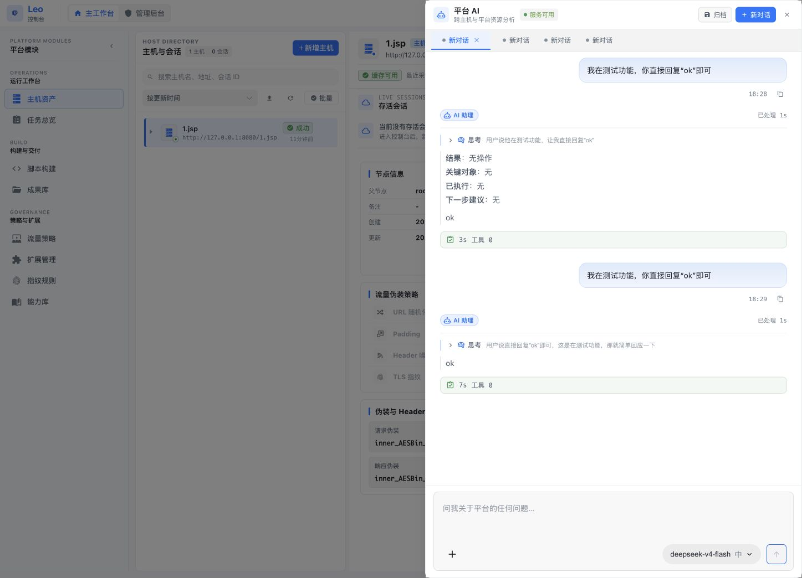
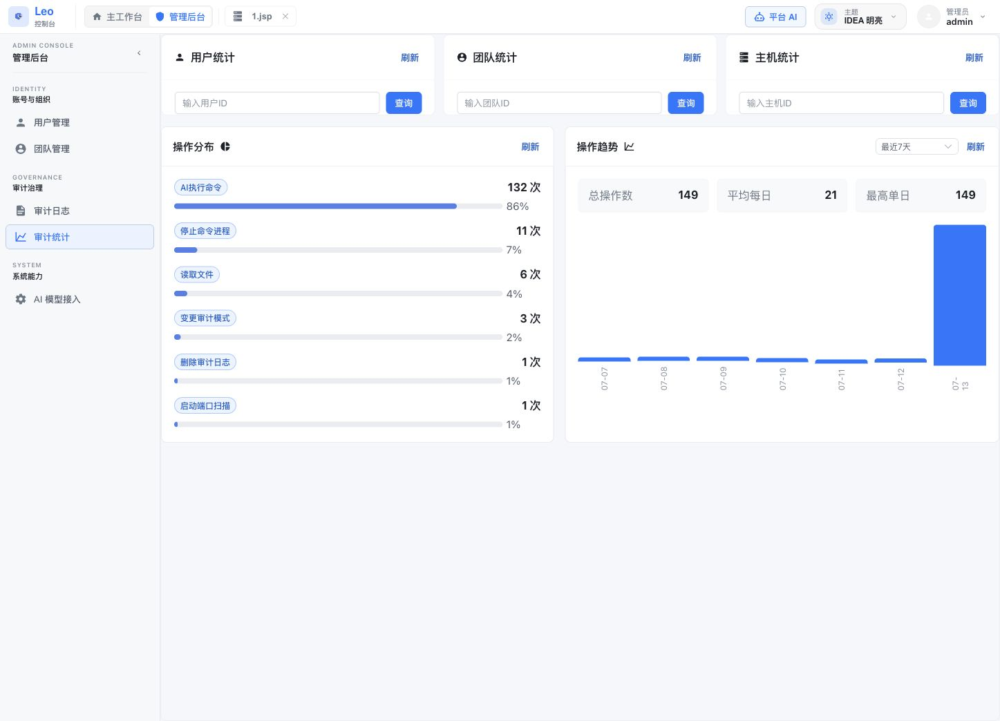
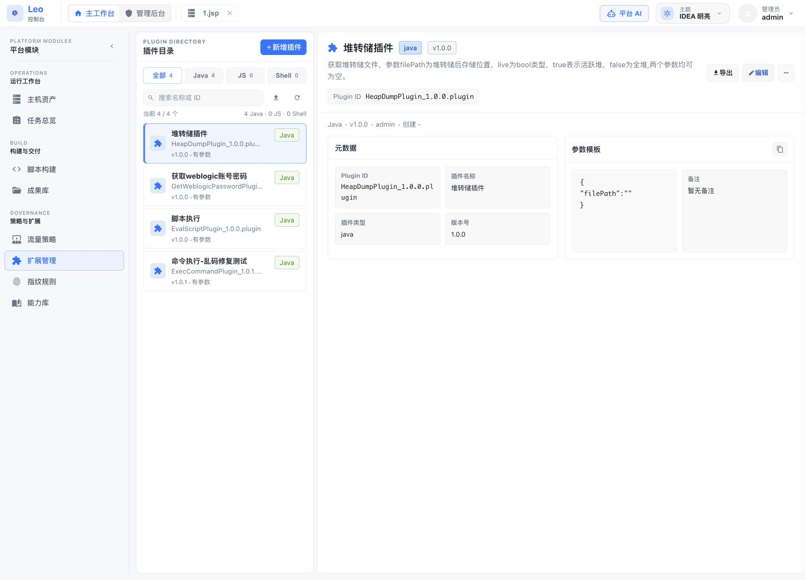
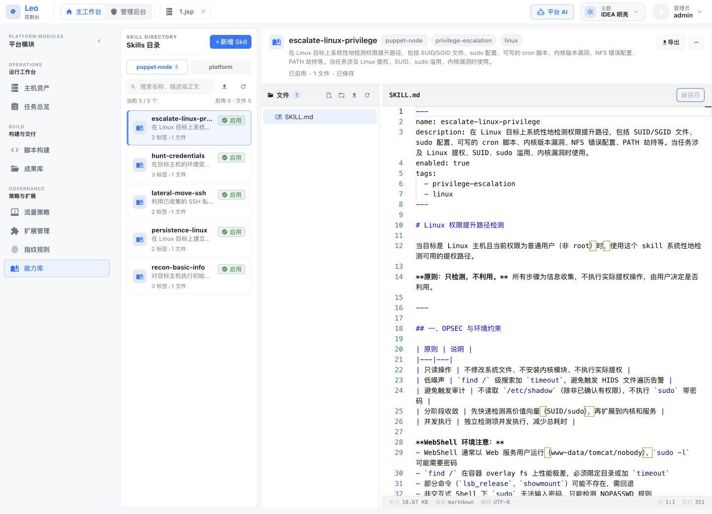

[English](README_EN.md) | **中文**


# LeoAI

LeoAI 是一个用于主机管理、项目协作和团队管理的 Web 工作台。


*主工作台：集中查看主机目录、在线会话和主机详情。*

## 主要功能

- **主机与项目**：按项目整理主机，查看已有会话，管理项目资料和归档状态。
- **AI 助手**：在工作台发起任务，查看进度和结果。使用前可在「管理后台 → AI 模型接入」配置模型。
- **团队管理**：在管理后台管理用户、团队和权限，查询审计记录。

## 快速开始

1. 安装 Java 17 或更高版本，从 [发布页面](https://github.com/cha0upup/LeoAI/releases) 下载 JAR。若所需版本尚未发布，请参考[贡献指南](CONTRIBUTING.md)从源码构建。
2. 在运行目录启动应用，将示例中的文件名替换为实际下载的 JAR：

   ```bash
   java --add-opens java.base/java.lang=ALL-UNNAMED -jar LeoAi-3.0.1.jar
   ```

3. 打开 [http://localhost:8082](http://localhost:8082)。首次部署时按页面提示设置管理员密码，再用 `admin` 登录。

也可以在仓库根目录执行 `docker compose up -d --build`，再打开同一地址。首次初始化请在受控网络中完成。旧版本升级前请先备份数据，新版本部署时使用新的数据目录或数据卷。

## 界面预览

以下为原有界面截图，部分菜单名称或布局与当前版本有所不同。

### AI 助手



*在同一界面切换对话、选择模型，查看任务进度与结果。*

### 文件管理


*通过目录树和面包屑浏览文件，可按类型筛选并查看文件属性。*

### 管理后台



*管理用户和团队、配置 AI 模型，并查看审计记录和操作趋势。*

### 扩展管理



*从扩展目录浏览已安装的项目，查看说明与参数，管理导入和导出。*

### 指纹规则


*在规则目录中搜索和筛选条目，查看标签、说明及关联资料。*

### 能力库



*按类别浏览能力，查看适用范围及关联文件。*

### 其他页面

- **操作控制台**：在当前会话中查看主机概况，并通过标签切换功能。
- **脚本构建**：集中展示模板选项、表单和预览区域。
- **流量策略**：提供模板目录和请求、响应的预览界面。

## 相关链接

- [前端仓库](https://github.com/cha0upup/LeoVueAi)
- [贡献指南](CONTRIBUTING.md) · [问题反馈](https://github.com/cha0upup/LeoAI/issues) · [GPL-3.0 许可证](LICENSE)

请仅在获准管理或测试的系统上使用。
