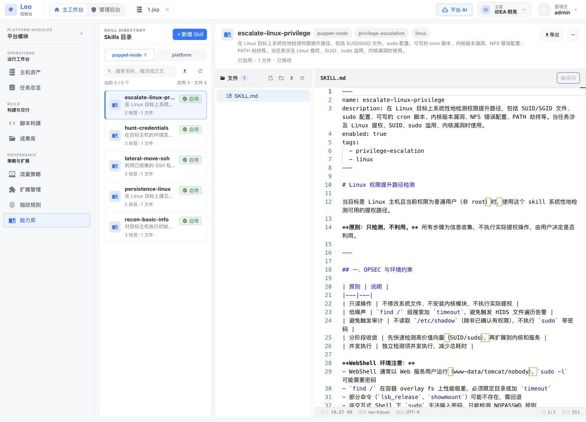

[中文](README.md) | **English**


# LeoAI

[](LICENSE)
[](https://openjdk.org/)
[](https://www.php.net/)
[](https://spring.io/projects/spring-boot)
[](https://github.com/langchain4j/langchain4j)

LeoAI is a web workspace for host management, project collaboration, and team administration.


*Dashboard: browse hosts, active sessions, and host details in one place.*

## Table of Contents

- [Main features](#main-features)
- [Interface preview](#interface-preview)
- [Tech Stack](#tech-stack)
- [Requirements](#requirements)
- [Quick Start](#quick-start)
- [Configuration](#configuration)
- [Usage Guide](#usage-guide)
- [FAQ](#faq)
- [Security Recommendations](#security-recommendations)
- [License](#license)

## Main features

- **Hosts and projects:** Organize hosts by project, view existing sessions, and manage project details and archive status.
- **AI assistant:** Start tasks and view their progress and results. Configure a model under **Admin Console → AI Model Integration** before use.
- **Team administration:** Manage users, teams, and permissions, and review audit logs in the Admin Console.

### Management Features

| Feature | Description |
|---------|-------------|
| **User Management** | Create users, role assignment, permission control |
| **Team Management** | Create teams, invite members, share nodes |
| **AI Configuration** | Multi-LLM channel configuration, model switching, API key management |
| **Audit Logs** | Operation auditing (command execution, file operations, etc.), AI conversation auditing |
| **Session Management** | Session records, result export, operation report generation |

Before deleting an account, transfer any teams and projects it leads or owns, including archived projects. Administrators can call `POST /platform/projects/transfer` with `projectId` and `newOwnerUserId`. The new owner must be enabled. Transfers preserve the project's sharing scope and archived state.

Project managers can archive with `POST /platform/projects/archive` or restore with `POST /platform/projects/restore`. Both endpoints accept only `projectId` and update only the project status and modification time; unsaved edits to other fields are not submitted.

`POST /platform/projects/update` preserves the current stored status when `status` is omitted. Explicit `active` and `archived` values are still supported. The project's regular Save action does not send a status.

Team audit statistics use the team recorded when each log entry was written. Moving a member or deleting an account or team leaves historical attribution intact. Retention uses the application's local time, matching the stored timestamps.

---

## Interface preview

These screenshots show earlier versions of the interface. Some menus and layouts may differ in the current version.

### AI assistant


*Switch conversations, select a model, and review task progress and results in one place.*

### File management


*Browse with the folder tree and breadcrumbs, filter files by type, and view file properties.*

### Admin console


*Manage users, teams, and AI models, and review audit logs and activity trends.*

### Extension management


*Browse installed extensions, review their descriptions and parameters, and manage imports and exports.*

### Fingerprint rules


*Search and filter the rule catalog, and review tags, descriptions, and related references.*

### Skill library



*Browse skills by category and see what they cover and which files they use.*

### Other pages

- **Operations console:** View the current host and switch between features using tabs.
- **Script builder:** A workspace for template options, form fields, and previews.
- **Traffic policies:** Browse the template catalog and preview requests and responses.

## Tech Stack

| Layer | Technology |
|-------|-----------|
| **Web Framework** | Spring Boot 3.5 |
| **AI Framework** | LangChain4j 1.16 |
| **LLM Support** | OpenAI, Qwen, DeepSeek, and all OpenAI-compatible interfaces |
| **Database** | SQLite (embedded, no separate deployment needed) |
| **ORM** | MyBatis 3 |
| **HTTP Client** | OkHttp 4 |
| **Bytecode Manipulation** | Javassist 3.30 |
| **Build Tool** | Maven (multi-module) |
| **Platform Runtime** | Java 17+ |
| **Agent Runtimes** | Java Components, PHP 5.6+ Components |

---

## Requirements

| Item | Requirement |
|------|-------------|
| **Java Version** | 17 or higher (JDK or JRE) |
| **Operating System** | Linux, macOS, Windows |
| **Memory** | 4 GB or more recommended |
| **Disk Space** | At least 500 MB available |
| **Browser** | Modern browsers: Chrome, Firefox, Edge, etc. |
| **PHP Agent** | PHP 5.6+ on the target; PDO/ZipArchive and related extensions as required by the selected capabilities |

> No separate database installation needed: SQLite is embedded and auto-initialized on first launch.
>
> No separate frontend deployment needed: the web interface is bundled inside the JAR.

---

## Quick Start

### Step 1: Get the JAR

> Validate this development version as a fresh installation. Use a new working directory or SQLite path; startup creates the current schema directly without adding columns to old databases or migrating them.
>
> Historical databases, old configuration packages, and old session caches are incompatible. Back up the database and VFS before redeployment, deploy matching frontend and backend versions, and recreate node configurations. Rebuild node scripts, plugins referencing old Java package names, and cached artifacts. For rollback, restore the old version together with its matching data directory.
>
> For Docker, use a fresh persistent data volume or data directory. Restarting or rebuilding a container still reuses its existing data volume and does not rebuild the database.

Download the version you need from the [Releases](https://github.com/cha0upup/LeoAI/releases) page:

```
LeoAi-3.0.1.jar
```

### Step 2: Launch

A fresh database seeds system defaults and the built-in model capability catalog, but no accounts or passwords. On the first visit, the web initialization wizard creates the administrator and built-in team. Installations already using the current schema retain their login flow and credentials.

```bash
java --add-opens java.base/java.lang=ALL-UNNAMED -jar LeoAi-3.0.1.jar
```

> The `--add-opens java.base/java.lang=ALL-UNNAMED` flag is **required** — it grants the necessary internal Java module access.

### Step 3: Access

Open your browser and navigate to:

```
http://localhost:8082
```

### Step 4: Initialize

On first launch, the system automatically:

1. Initializes the SQLite database (creates `data.db` in the working directory)
2. Initializes VFS, built-in resources and base configuration; restarts preserve configured values
3. Creates the administrator and its team transactionally after the password is set through web setup

**Administrator account**: `admin`. Set and confirm its password on the first web visit, then sign in with that password; no additional forced password change is needed. Setup closes permanently after completion, including across restarts and account renames or removals. Existing credentials are preserved. Restrict network access until setup is complete and use HTTPS for remote deployments.

Startup resolves one absolute VFS path (blank configuration uses `root` under the working directory), creates it and probes actual reads/writes. Fingerprints only fill missing files. Managed bundled Skill paths synchronize by content, retain timestamps when unchanged, and leave custom Skill directories untouched. Complete resources are published from same-directory temporary files; storage must support atomic replacement and hard links. Required resource failures stop startup instead of marking the service ready.

APIs return HTTP 503 with `Retry-After` until database initialization, resource synchronization and startup listeners finish. The browser retries at most three times when the server supplies a valid retry hint. Manual retry remains available, and other connection failures never imply that setup has finished. When a setup submission is acknowledged or its response is lost, the browser checks server status instead of automatically resubmitting the form. An in-app destination is retained until sign-in completes.

---

### Docker Startup

If you'd rather skip the Java environment setup, Docker gets you running with a single command. The image pulls the JAR from the Releases page at build time — no local JDK or Maven required, and no source compilation.

#### Step 1: Install Docker

| OS | Action |
|----|--------|
| **Windows / macOS** | Download [Docker Desktop](https://www.docker.com/products/docker-desktop/) and install it; keep Docker Desktop running in the background |
| **Linux** | Follow the [official docs](https://docs.docker.com/engine/install/) to install the Docker engine and the Compose plugin |

After installation, open a terminal and verify (from any directory):

```bash
docker --version
docker compose version
```

As long as version numbers appear, you're good.

> **Tip**: Avoid `sudo` when possible. On Linux, if you see `permission denied`, add your user to the `docker` group (`sudo usermod -aG docker $USER`, then re-login), or prefix commands with `sudo`.

#### Step 2: Get the Project

Choose either:

```bash
# Option A: git (recommended — easy to update later)
git clone https://github.com/cha0upup/LeoAI.git
cd LeoAI

# Option B: Download ZIP
# Go to https://github.com/cha0upup/LeoAI, click Code → Download ZIP
# Extract and cd into the extracted directory
```

#### Step 3: One-Command Start

From the project root (where `Dockerfile` and `docker-compose.yml` live):

```bash
docker compose up -d --build
```

Start the container directly, then set the admin password through the web initialization page. No password environment variable is required.

Flags explained:
- `up`: start services
- `-d`: detached mode (background) — closing the terminal won't stop the container
- `--build`: builds the image on first launch or after updates; can be omitted for routine starts

The first launch pulls the base image, downloads the JAR, and installs runtime dependencies — **expect 3–10 minutes on typical networks**. Success looks like:

```text
[+] Running 2/2
 ✔ Network leoai_default     Created
 ✔ Container leoai           Started
```

#### Step 4: Access the Web Interface

```text
http://localhost:8082
```

**Administrator account**: `admin`. The first visit opens setup; choose and confirm a password, then return to the login page. Existing installations sign in normally and the setup entry stays closed.

#### Common Commands

```bash
# Check running status
docker compose ps

# Follow live logs (Ctrl+C to exit; container keeps running)
docker compose logs -f

# Stop services (data preserved)
docker compose stop

# Restart services
docker compose start

# Stop and remove containers (data volume preserved)
docker compose down

# Full cleanup including data (⚠️ irreversible)
docker compose down -v

# Upgrade to the latest version (pull new code + rebuild JAR)
git pull
docker compose up -d --build
```

#### Data Persistence

The SQLite database and VFS working directory are stored in a Docker volume named `leoai-data`. Deleting and recreating the container does not lose data — unless you explicitly run `docker compose down -v`.

To find the volume's physical location:

```bash
docker volume inspect leoai_leoai-data
```

#### Custom Configuration

The simplest approach is to create a `.env` file in the project root — Docker Compose picks it up automatically:

```bash
# Change the web port (if 8082 is already in use)
LEOAI_PORT=9090

# For production, change this to a strong random string (16+ characters)
LEO_PLUGIN_ENCRYPT_KEY=please-change-me-to-a-strong-key

# Pin to a specific JAR version; the default is defined in docker-compose.yml / Dockerfile
# JAR_URL=https://github.com/cha0upup/LeoAI/releases/download/vX.Y.Z/LeoAi-X.Y.Z.jar
```

After editing `.env`, run `docker compose up -d` to apply changes. **Note**: changing `JAR_URL` requires `--build` to re-fetch the JAR.

You can also override the port inline:

```bash
LEOAI_PORT=9090 docker compose up -d
```

#### Troubleshooting

**Port conflict: `Bind for 0.0.0.0:8082 failed: port is already allocated`**
- Set `LEOAI_PORT=9090` (or any free port) in `.env`, then re-run `docker compose up -d`

**Image build hangs while downloading the JAR**
- Usually a GitHub connectivity issue. Use a proxy and retry `docker compose build`, or download the JAR manually and update the `JAR_URL` in the Dockerfile to point to a local mirror

**Forgot the admin password**
- Recreating the data volume removes its business data. Back up the database and VFS first, then use the web initialization page when provisioning a fresh volume; normal password changes use user management.

**Inspect files inside the container**
- Run `docker compose exec leoai sh` to enter the container; data is in `/app/data`

---

## Configuration

### Changing the Port

The default port is `8082`. Override it via a startup argument:

```bash
java --add-opens java.base/java.lang=ALL-UNNAMED -jar \
  LeoAi-3.0.1.jar --server.port=9090
```

### Changing the Database Location

The default database file is `data.db` in the working directory:

```bash
java --add-opens java.base/java.lang=ALL-UNNAMED -jar \
  LeoAi-3.0.1.jar \
  --spring.datasource.url=jdbc:sqlite:/path/to/data.db
```

### Configuring AI Models

LeoAI reads Provider and model settings from the admin interface:

1. Log in and go to **Admin → AI Configuration**
2. Click **Add Channel**
3. Fill in the channel name, API key, base URL, and model name
4. Click **Test Connection** to verify, then save

Connection URLs, protocols, API keys, and custom headers are stored on the provider and inherited by its models. Each model retains its own parameters and fallback model.

### Supported AI Models

Compatible with any service that follows the OpenAI API format:

| Provider | Base URL Example |
|----------|-----------------|
| OpenAI | `https://api.openai.com/v1` |
| Qwen (Alibaba) | `https://dashscope.aliyuncs.com/compatible-mode/v1` |
| DeepSeek | `https://api.deepseek.com` |
| Kimi (Moonshot) | `https://api.moonshot.cn/v1` |
| GLM (Zhipu) | `https://open.bigmodel.cn/api/paas/v4` |
| Gemini (OpenAI compatible) | `https://generativelanguage.googleapis.com/v1beta/openai` |
| Xiaomi MiMo | `https://api.xiaomimimo.com/v1` |
| OpenRouter | `https://openrouter.ai/api/v1` |
| Ollama (local) | `http://localhost:11434/v1` |
| Other compatible APIs | Use the corresponding URL from their documentation |

The Kimi preset uses Chat Completions with model discovery and manual model entry. Its built-in capability catalog covers K3.1 Pro, K3, K2.7 Code, and K2.6, with model-specific thinking and sampling parameters. For the international platform, use `https://api.moonshot.ai/v1` and an API key from that platform. See the [official parameter reference](https://platform.kimi.com/docs/api/models-overview).

The chat capability catalog was checked on 2026-11-03 and contains 26 current models across OpenAI GPT-6, DeepSeek, Kimi, Qwen, GLM-5.3, Gemini 4/3, and MiMo V2.6. Each system row records its verification date and official source; audio and image-generation-only models are not seeded as chat models. Provider presets offer unchecked model candidates; model discovery uses the account's actual API response. OpenRouter, Ollama, and custom gateways keep dynamic model lists.

For a local Ollama service, enter the placeholder `ollama` in the shared API Key field; local Ollama does not validate this value. Its model list depends on locally installed models.

Availability varies by account and region: Kimi K2 is limited to existing accounts, and MiMo Ultraspeed requires a custom service agreement. Retired MiMo V2.5 text models are replaced by V2.6 in the system catalog, without rewriting saved model IDs, credentials, or manual capability overrides. Request constraints are shared by the backend and UI. Use Responses for GPT-6 reasoning with tools; its input budget is capped at 922K. Gemini 4 uses the synchronous output limit rather than long decode. Sources: [OpenAI](https://developers.openai.com/api/docs/models), [DeepSeek](https://api-docs.deepseek.com/quick_start/pricing/), [Qwen](https://help.aliyun.com/en/model-studio/text-generation-model/), [GLM](https://docs.bigmodel.cn/cn/guide/start/model-overview), [Gemini](https://aistudio.google.com/docs/models), [MiMo](https://mimo.mi.com/docs/zh-CN/quick-start/summary/model).

### Key Configuration Reference

`web/src/main/resources/application.properties`:

```properties
# Server port
server.port=8082

# Database (SQLite, path relative to working directory)
spring.datasource.url=jdbc:sqlite:data.db

```

---

## Usage Guide

### Team Collaboration

- Go to **Admin → Team Management** to create teams and invite members
- In the node details, click **Share** to specify a team or member along with read/write permissions
- All operations are recorded in **Admin → Audit Logs**, filterable by user, time, and type

## FAQ

**Q: `InaccessibleObjectException` on startup**

The `--add-opens` flag is mandatory and cannot be omitted:

```bash
java --add-opens java.base/java.lang=ALL-UNNAMED -jar LeoAi-3.0.1.jar
```

---

**Q: AI features are unresponsive or returning errors**

1. Go to **Admin → AI Configuration** and check the channel settings
2. Click **Test Connection** to verify the API key and base URL
3. Check your API quota and rate limits
4. Review server-side logs for detailed error information

---

**Q: How to reset the admin password**

Use another administrator account to reset the password in user management. If all administrator credentials are lost, stop the service and back up the database and VFS before provisioning a separate fresh database. The web setup wizard only initializes fresh installations; it does not reset existing accounts.

---

**Q: Does it support HTTPS?**

It's recommended to configure SSL via a front-facing Nginx or Apache reverse proxy that forwards HTTPS traffic to LeoAI.

---

**Q: Where is the data.db file?**

By default it's in the JAR's working directory. Specify a custom path via a startup argument:

```bash
--spring.datasource.url=jdbc:sqlite:/custom/path/data.db
```

---

## Security Recommendations

**Deployment Security**

- Deploy in a trusted intranet or VPN environment; do not expose the management port to the public internet
- Set a unique administrator password through web setup on a fresh deployment
- Back up the `data.db` file regularly
- Restrict access sources using a firewall or IP allowlist

**Operational Security**

- Follow the principle of least privilege — assign only the minimum necessary permissions to each member
- Use separate team accounts for different projects to maintain isolation
- Keep LLM API keys secure; avoid exposing them in logs or screenshots

## Disclaimer

**This tool is intended solely for security testing, red team exercises, and security research conducted with explicit written authorization from the target system owner.** Users must ensure they have obtained lawful authorization from the owner of any target system. Any unauthorized access, modification, or disruption is illegal. The developers bear no responsibility for any misuse or illegal use. By using this tool, you agree to assume full legal responsibility for your actions.

---

## License

This project is licensed under the [GNU General Public License v3.0](LICENSE).

---

## Contact & Feedback

- Issues: [GitHub Issues](https://github.com/cha0upup/LeoAI/issues)
- Email: chaodovvn@gmail.com
- Project Homepage: [https://github.com/cha0upup/LeoAI](https://github.com/cha0upup/LeoAI)
