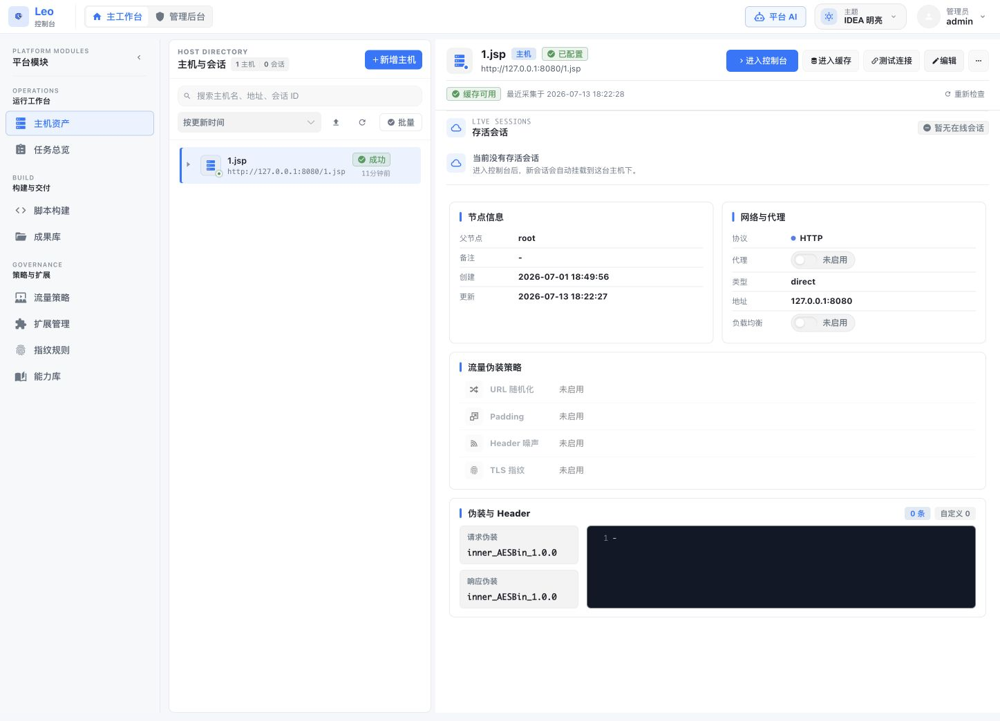
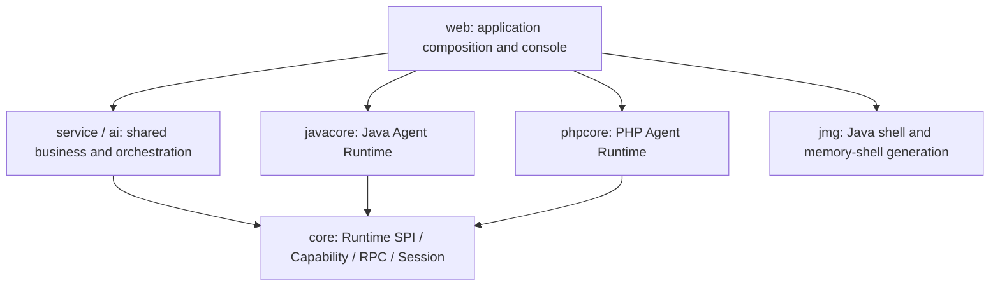
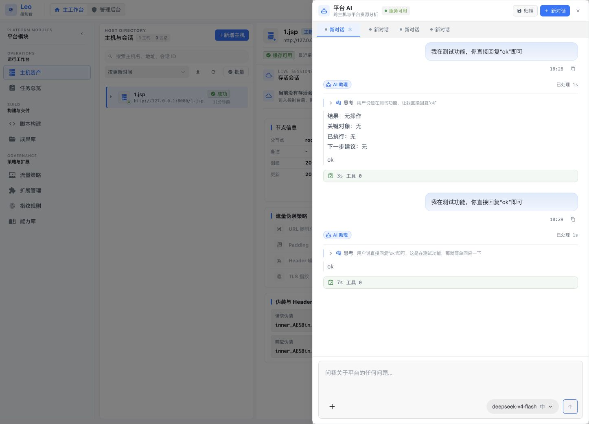
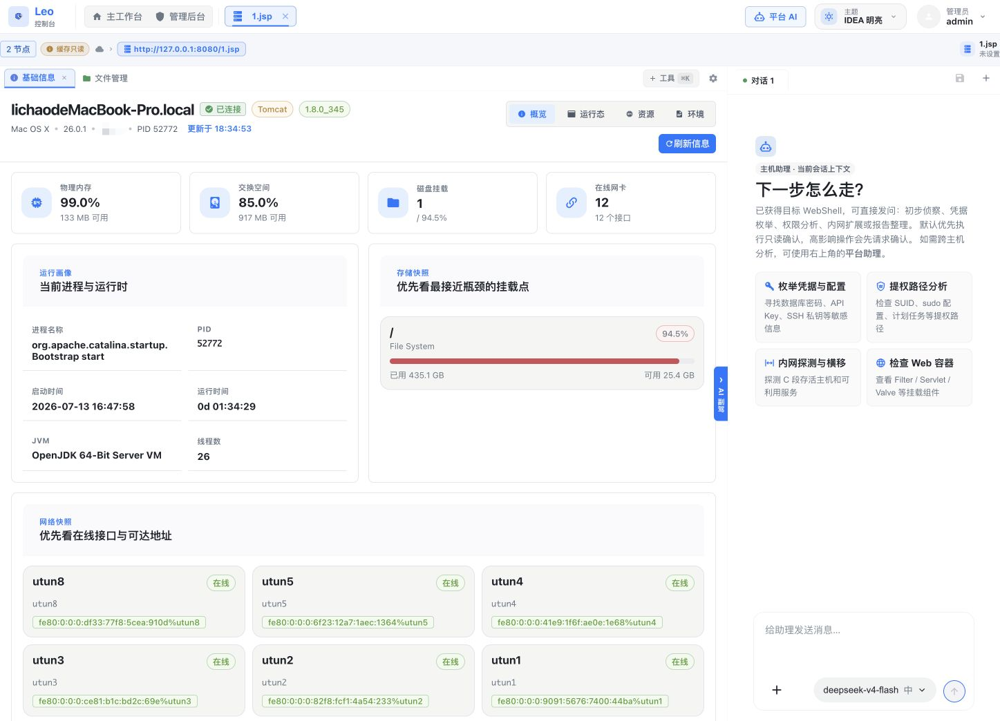

**English** | [中文](README.md)

<div align="center">


# LeoAI

**AI-Powered Post-Exploitation Management Platform**

[](LICENSE)
[](https://openjdk.org/)
[](https://www.php.net/)
[](https://spring.io/projects/spring-boot)
[](https://github.com/langchain4j/langchain4j)

LeoAI is a post-exploitation management platform designed for red team operators and security research workflows. v3.0.0 introduces equal Java and PHP Agent runtimes: the platform discovers each node's capabilities and assembles the console and AI tools accordingly. LeoAI combines AI-assisted decision making, multi-protocol communication, node operations, and team collaboration in a built-in web interface.



*Main interface: node list, detail panel, and traffic disguise strategy configuration*

</div>

> **Node naming**: execution nodes use Agent / AgentNode; AI interfaces use NodeAiAgent / PlatformAiAgent. See the [Agent naming and deployment guide](docs/agent-naming.md).
>
> **Historical data is incompatible**: redeploy this version with a fresh database path or data directory to rebuild the database. Existing databases are not upgrade inputs; the first startup creates tables from the current `schema.sql` and initializes seed data.

---

## Table of Contents

- [v3.0.0 Highlights](#v300-highlights)
- [Java/PHP Dual Runtime](#javaphp-dual-runtime)
- [Features](#features)
- [Tech Stack](#tech-stack)
- [Requirements](#requirements)
- [Quick Start](#quick-start)
- [Configuration](#configuration)
- [Usage Guide](#usage-guide)
- [FAQ](#faq)
- [Security Recommendations](#security-recommendations)
- [Disclaimer](#disclaimer)
- [License](#license)

---

## v3.0.0 Highlights

v3.0.0 is a major update spanning runtimes, components, platform services, the web console, and deployment. It unifies Agent terminology and uses a fresh database baseline that is incompatible with historical data.

| Area | What changed in v3.0.0 |
|------|-------------------------|
| **PHP Agent** | Adds a PHP 5.6+ single-file entry point, HTTP RPC, on-demand Components, and runtime capability registration for commands, files, terminals, databases, networking, tunnels, and core system administration |
| **Dual-runtime architecture** | Java and PHP use the same `AgentRuntimeModule` SPI, Capability contracts, and RPC response protocol; upper layers depend on capabilities rather than a concrete runtime |
| **Component reliability** | Java/PHP Components now use bounded tasks, TTLs, resource deregistration, cache limits, and unified lifecycle cleanup; Java artifacts also remove redundant debug metadata and constants |
| **Console and AI** | Agent routing, plugins, file transfer, SQL, proxies, background tasks, and AI SSE use shared service boundaries; the UI exposes features from each node's Runtime Profile |
| **Fresh database baseline** | `schema.sql` and `data.sql` create the final v3.0.0 structure directly, followed by base configuration and administrator bootstrap |
| **Release packaging** | Maven modules, frontend assets, Docker configuration, and artifacts use version `3.0.0`; the release artifact is `LeoAi-3.0.0.jar` and the initial administrator password must be changed after login |

> **Installation baseline:** v3.0.0 is distributed as a fresh installation. Use a new data directory for the official release; database files, Component caches, and generated artifacts from development builds are not upgrade inputs.

---

## Java/PHP Dual Runtime

Java and PHP are equal Agent runtimes. Shared modules define protocols, sessions, and capability contracts; concrete implementations live in `javacore` and `phpcore`, while `web` is the application composition root.



| Capability | Java Agent | PHP Agent |
|------------|-------------|------------|
| **Entry point** | Java Core plus container/script generators | PHP 5.6+ single-file HTTP entry point |
| **Component loading** | Independent Java Component bytecode loaded on demand | Independent PHP Components loaded lazily by digest |
| **Commands and terminal** | `ProcessBuilder`, PTY/pipe sessions | `proc_open`, Python PTY/command backend |
| **Files** | Browse, edit, chunked transfer, archive, and hash | Browse, edit, chunked transfer, archive, and hash |
| **Database** | Shared connection description converted to JDBC parameters | Shared connection description converted to a PDO DSN |
| **Networking** | HTTP, scans, SOCKS5/HTTP proxies, local/reverse tunnels | HTTP, scans, SOCKS5/HTTP proxies, local/reverse tunnels |
| **Discovery** | Declared dynamically through Runtime Profile | Declared dynamically through Runtime Profile |

The exact PHP feature set depends on the target environment: database operations require the matching PDO driver, archives require `ZipArchive`, and persistent proxy/tunnel workers require at least one of `shell_exec`, `exec`, or `popen`. See [docs/runtime-modules.md](docs/runtime-modules.md) for module boundaries and the full capability matrix.

---

## Features

### AI & Intelligence

| Feature | Description |
|---------|-------------|
| **AI Agent Automation** | Built on LangChain4j, supports multi-turn tool calls with parallel execution to automatically plan and execute post-exploitation operations |
| **Multi-Model Support** | Compatible with OpenAI, Qwen, DeepSeek, Claude, and OpenAI-compatible APIs; hot-swappable at runtime |
| **Large Context Window** | Dynamically adapts to model context windows (up to 1M tokens); auto-compresses history to preserve key information |
| **Task Planning** | AI auto-plans multi-step tasks, executes sequentially with result writeback, tracked in real-time via sticky top bar |
| **100+ AI Tools** | Atomic capabilities callable by the AI Agent — covering command execution, files, networking, credentials, scanning, HTTP requests, databases, scripting, plugins, and more |
| **Built-in AI Skills** | Pre-configured agent-node / platform task prompts for launching reconnaissance, credential hunting, privilege escalation, persistence, lateral movement, disguise development, fingerprint development, and exploit suggestion workflows |
| **Skill Manager** | Visually manage Skills: view/edit content and descriptions, tag categorization, enable/disable, full-text search, import/export — changes take effect immediately without restarting |
| **Context Accumulation** | Reconnaissance summaries accumulate and compress automatically; AI context grows richer as operations deepen |
| **Operation Report Generation** | AI automatically generates operation summaries and risk analysis reports |



*AI assistant automatically invoking recon tools, analyzing results, and generating a reconnaissance summary*

### Node Management

| Feature | Description |
|---------|-------------|
| **Multi-Protocol Communication** | HTTP, HTTP Chunked (large file transfer), WebSocket (real-time interaction) |
| **Traffic Concealment** | TLS fingerprint spoofing, header noise injection, URL randomization, custom request/response encoding |
| **Proxy & Tunneling** | HTTP proxy, SOCKS5 proxy, local port forwarding (ssh -L style), reverse tunneling (ssh -R style) |
| **Team Collaboration** | Nodes can be shared among team members with controllable permissions |
| **Batch Node Management** | Node grouping, tag management, bulk operations |

### Operations Console Toolset

#### Interactive & Command Execution
- **Virtual Terminal**: Multi-session interactive shell based on xterm.js, with real-time streaming output, session search, clear, interrupt, close, and backend process lifecycle cleanup
- **Background Tasks**: Asynchronous execution of long-running commands, with output polling and task cancellation

#### Files & Storage
- **File Manager**: Tree-style directory browsing, upload/download, online editing, compress/decompress, preview (text/image/PDF), chunked transfer for large files
- **User File Space**: Independent local file storage area for each user

#### Database & Information Systems
- **Database Console**: Supports MySQL, PostgreSQL, Oracle, SQLite, SQL Server — with SQL editor and table structure browser
- **Registry Manager** (Windows): Browse and modify registry keys and values
- **Event Log Viewer**: Query Windows system event logs
- **Firewall Manager**: View and modify firewall rules

#### Network & Scanning
- **Port Scanner**: TCP port scanning, host discovery (Ping Sweep)
- **Fingerprint Identification**: Web service identification from HTTP request and response evidence, with support for custom rules
- **Reconnaissance Scanning**: Concurrent multi-target, multi-rule recon with results automatically aggregated into AI context
- **HTTP Requester**: Repeater (single request) and Fuzzer (bulk fuzzing)
- **Proxy & Tunneling**: Use HTTP proxy, SOCKS5 proxy, local port forwarding (ssh -L), or reverse tunnel (ssh -R) through target nodes — with connection count and traffic monitoring

#### System Management
- **Screenshot**: Real-time capture of target desktop
- **Process Manager**: List, kill, and create processes
- **Scheduled Tasks**: Windows scheduled task management
- **Service Manager**: Start, stop, restart Windows services
- **Docker Manager**: List, start, stop, and inspect containers and images
- **Java Web Runtime Management**: runtime profiles for Tomcat 6–11, WebLogic 10/12/14, Jetty, Undertow, JBoss/WildFly, WebSphere, Spring MVC, and Spring WebFlux; supports removing Filter / Servlet / Valve / Listener / Controller / Interceptor

#### Security & Permissions
- **Credential Harvesting**: System credentials and browser data
- **SUID/Capability Check**: Quickly identify Linux privilege escalation vectors
- **User Account Management**: Enumerate and manage users on target hosts
- **Network Connection Viewer**: View active connections, network shares, and installed software

#### Other Tools
- **Class Bytecode Viewer**: Extract and decompile classes loaded in the JVM
- **Class & Resource Browser**: Read any classpath resource the agent process can see (`.class` files inside jars, `application.yml`, `META-INF/MANIFEST.MF`, etc.) by class name or path. Auto-detects binary/text/`.class` and decompiles to Java source. When the agent is injected into Tomcat's global ClassLoader, falls back to scanning every WebappClassLoader so webapp-private classes remain reachable.
- **HostId Switching**: Manage multiple intranet hosts under a single node



*Operations console: basic info overview, AI skill quick-launch panel, and chat area*

### Shell Generator

#### Memory Shell Generation
- Supported types: Filter, Servlet, Listener, Valve, Interceptor, Controller, WebSocket, HTTP UpgradeProtocol, WebFlux WebFilter/HandlerMethod/HandlerFunction, Netty Handler, and Dubbo Service
- Supported middleware: Tomcat, Jetty5, Jetty, JBoss/JBossAS, JBossEAP6, JBossEAP7, Wildfly, Undertow, Resin2, Resin, Glassfish, Payara, WebLogic, WebSphere, SpringWebMVC, Apusic, BES, InforSuite, TongWeb, Struts2, SpringWebFlux, XXL-JOB, and Dubbo (24 total)
- TongWeb Valve runtime contracts are selected by major version: 6 → `com.tongweb.web.thor`, 7 → `com.tongweb.catalina`, and 8 → `com.tongweb.server`; the UI and API require `serverVersion`
- Agent mounts cover FilterChain and ContextValve for Tomcat/JBoss/GlassFish/Payara/InforSuite/TongWeb, Jetty Handler, Undertow ServletHandler, Resin FilterChain, WebLogic ServletContext, WebSphere FilterManager, Spring MVC FrameworkServlet, Apusic, and BES. Jetty 7–11 also provides an ordinary root Handler mount. Tomcat WebSocket includes a reverse-proxy-compatible mount that supplies Upgrade headers through a single-class JDK Proxy Valve. Tomcat 8.5–11 also exposes a connector-level `UpgradeInjector`; generated metadata reports the `Connection: Upgrade` and dynamic `Upgrade: <shellClassName>` activation headers while retaining header gates, custom response codes, HTTP Chunk, and Lambda class-name suffixes.
- `AgentJarBase64` emits a `premain`/`agentmain` manifest for `-javaagent` and Attach API loading
- XXL-JOB 2.2–2.5 uses `XxlJob`/`XxlJobJson` request bodies, while 2.0–2.1 uses `XxlJobHessian`; the capability catalog validates the Packer against `serverVersion`
- Packers: OGNL, SpEL, EL, Groovy, Freemarker, MVEL, BeanShell, Velocity, Thymeleaf, JEXL, Jinjava, JXPath, Rhino, Aviator, ScriptEngine, BCEL, Translet, XmlDecoder, H2, Base64, Hex, JarBase64, AgentJarBase64, XXL-JOB JSON/Hessian, and more (49 total)
- Build strategies: Lambda-shaped class suffixes, Injector static initialization, optional class shrinking, and automatic JDK 9+ module compatibility. Capability metadata hides URL configuration for global mounts and disables static initialization for Agent mounts. Packers receive Core, Shell, and Injector class entries together.

#### WebShell Generation
- Supported formats: JSP, JSPX, Groovy

Every Java build keeps the final Packer text and also exposes downloadable Core,
Shell, and Injector class artifacts with byte sizes and server-generated SHA-256 digests.

### Fingerprint & Identification Rules

- **Built-in Rule Library**: HTTP fingerprint rules that can match request data, response headers, status codes, and response bodies
- **Custom Rules**: Add, edit, enable/disable fingerprint rules via the "Identification Rules" page
- **Rule Tags**: Supports tag grouping for selective use during scanning
- **Import/Export**: Export individual rules or batch-export as `.json` / `.zip`; import with conflict policies (skip/overwrite/rename) to easily share rule libraries across teams

### Plugins & Script Execution

- **Unified execution console**: the "Scripts & Plugins" module hosts both script editing and bytecode execution
  - **Script editor**: JavaScript / Groovy / Python; run ad-hoc without saving, or save as a script plugin in one click
  - **Java class execution**: drag-and-drop a `.class` file or paste base64 bytecode (URL-safe / whitespace / padding cleanup, `cafebabe` magic check); run ad-hoc or save as a Java plugin
- **Unified plugin library**: Java bytecode and js/groovy/python script plugins coexist with type badges; script plugins can be reloaded into the editor with one click
- **Hot-loading Java plugins**: dynamically load and execute custom Java plugins
- **AI-ready built-in skills**: script execution, command execution, WebLogic password retrieval, heap-dump analysis, and more out of the box
- **Import/Export**: single-file `.plugin` or batch `.zip`; conflict policies (skip / overwrite) on import

### Management Features

| Feature | Description |
|---------|-------------|
| **User Management** | Create users, role assignment, permission control |
| **Team Management** | Create teams, invite members, share nodes |
| **AI Configuration** | Multi-LLM channel configuration, model switching, API key management |
| **Audit Logs** | Operation auditing (command execution, file operations, etc.), AI conversation auditing |
| **Session Management** | Session records, result export, operation report generation |

---

## Tech Stack

| Layer | Technology |
|-------|-----------|
| **Web Framework** | Spring Boot 3.5 |
| **AI Framework** | LangChain4j 1.16 |
| **LLM Support** | OpenAI, Qwen, DeepSeek, and all OpenAI-compatible interfaces |
| **Database** | SQLite (embedded, no separate deployment needed) |
| **ORM** | MyBatis 3 |
| **HTTP Client** | OkHttp 4 |
| **Bytecode Manipulation** | Javassist 3.30 |
| **Build Tool** | Maven (multi-module) |
| **Platform Runtime** | Java 17+ |
| **Agent Runtimes** | Java Components, PHP 5.6+ Components |

---

## Requirements

| Item | Requirement |
|------|-------------|
| **Java Version** | 17 or higher (JDK or JRE) |
| **Operating System** | Linux, macOS, Windows |
| **Memory** | 4 GB or more recommended |
| **Disk Space** | At least 500 MB available |
| **Browser** | Modern browsers: Chrome, Firefox, Edge, etc. |
| **PHP Agent** | PHP 5.6+ on the target; PDO/ZipArchive and related extensions as required by the selected capabilities |

> No separate database installation needed: SQLite is embedded and auto-initialized on first launch.  
> No separate frontend deployment needed: the web interface is bundled inside the JAR.

---

## Quick Start

### Step 1: Get the JAR

> **Historical data is incompatible; redeploy and rebuild the database.** Stop the old service and back it up, then deploy this version in a fresh working directory or with a new SQLite path. The first startup creates the current database structure; business data and node configurations need to be recreated.
>
> For Docker, use a fresh persistent data volume or data directory. Restarting or rebuilding a container still reuses its existing data volume and does not rebuild the database.

Download the version you need from the [Releases](https://github.com/cha0upup/LeoAI/releases) page:

```
LeoAi-3.0.0.jar
```

### Step 2: Launch

```bash
java --add-opens java.base/java.lang=ALL-UNNAMED -jar LeoAi-3.0.0.jar
```

> The `--add-opens java.base/java.lang=ALL-UNNAMED` flag is **required** — it grants the necessary internal Java module access.

### Step 3: Access

Open your browser and navigate to:

```
http://localhost:8082
```

### Step 4: Initialize

On first launch, the system automatically:

1. Initializes the SQLite database (creates `data.db` in the working directory)
2. Creates the default administrator account
3. Initializes base configuration

**Initial account**: `admin`, initial password: `54ikun`. The console requires a password change on first login.

---

### Docker Startup

If you'd rather skip the Java environment setup, Docker gets you running with a single command. The image pulls the JAR from the Releases page at build time — no local JDK or Maven required, and no source compilation.

#### Step 1: Install Docker

| OS | Action |
|----|--------|
| **Windows / macOS** | Download [Docker Desktop](https://www.docker.com/products/docker-desktop/) and install it; keep Docker Desktop running in the background |
| **Linux** | Follow the [official docs](https://docs.docker.com/engine/install/) to install the Docker engine and the Compose plugin |

After installation, open a terminal and verify (from any directory):

```bash
docker --version
docker compose version
```

As long as version numbers appear, you're good.

> **Tip**: Avoid `sudo` when possible. On Linux, if you see `permission denied`, add your user to the `docker` group (`sudo usermod -aG docker $USER`, then re-login), or prefix commands with `sudo`.

#### Step 2: Get the Project

Choose either:

```bash
# Option A: git (recommended — easy to update later)
git clone https://github.com/cha0upup/LeoAI.git
cd LeoAI

# Option B: Download ZIP
# Go to https://github.com/cha0upup/LeoAI, click Code → Download ZIP
# Extract and cd into the extracted directory
```

#### Step 3: One-Command Start

From the project root (where `Dockerfile` and `docker-compose.yml` live):

```bash
docker compose up -d --build
```

Flags explained:
- `up`: start services
- `-d`: detached mode (background) — closing the terminal won't stop the container
- `--build`: builds the image on first launch or after updates; can be omitted for routine starts

The first launch pulls the base image, downloads the JAR, and installs runtime dependencies — **expect 3–10 minutes on typical networks**. Success looks like:

```text
[+] Running 2/2
 ✔ Network leoai_default     Created
 ✔ Container leoai           Started
```

#### Step 4: Access the Web Interface

```text
http://localhost:8082
```

**Initial account**: `admin`, initial password: `54ikun`. The console requires a password change on first login.

#### Common Commands

```bash
# Check running status
docker compose ps

# Follow live logs (Ctrl+C to exit; container keeps running)
docker compose logs -f

# Stop services (data preserved)
docker compose stop

# Restart services
docker compose start

# Stop and remove containers (data volume preserved)
docker compose down

# Full cleanup including data (⚠️ irreversible)
docker compose down -v

# Upgrade to the latest version (pull new code + rebuild JAR)
git pull
docker compose up -d --build
```

#### Data Persistence

The SQLite database and VFS working directory are stored in a Docker volume named `leoai-data`. Deleting and recreating the container does not lose data — unless you explicitly run `docker compose down -v`.

To find the volume's physical location:

```bash
docker volume inspect leoai_leoai-data
```

#### Custom Configuration

The simplest approach is to create a `.env` file in the project root — Docker Compose picks it up automatically:

```bash
# Change the web port (if 8082 is already in use)
LEOAI_PORT=9090

# For production, change this to a strong random string (16+ characters)
LEO_PLUGIN_ENCRYPT_KEY=please-change-me-to-a-strong-key

# Pin to a specific JAR version; the default is defined in docker-compose.yml / Dockerfile
# JAR_URL=https://github.com/cha0upup/LeoAI/releases/download/vX.Y.Z/LeoAi-X.Y.Z.jar
```

After editing `.env`, run `docker compose up -d` to apply changes. **Note**: changing `JAR_URL` requires `--build` to re-fetch the JAR.

You can also override the port inline:

```bash
LEOAI_PORT=9090 docker compose up -d
```

#### Troubleshooting

**Port conflict: `Bind for 0.0.0.0:8082 failed: port is already allocated`**
- Set `LEOAI_PORT=9090` (or any free port) in `.env`, then re-run `docker compose up -d`

**Image build hangs while downloading the JAR**
- Usually a GitHub connectivity issue. Use a proxy and retry `docker compose build`, or download the JAR manually and update the `JAR_URL` in the Dockerfile to point to a local mirror

**Forgot the admin password**
- Run `docker compose down -v` to clear the data volume (⚠️ all data will be lost), then `docker compose up -d --build` to start fresh with the default credentials

**Inspect files inside the container**
- Run `docker compose exec leoai sh` to enter the container; data is in `/app/data`

---

## Configuration

### Changing the Port

The default port is `8082`. Override it via a startup argument:

```bash
java --add-opens java.base/java.lang=ALL-UNNAMED -jar \
  LeoAi-3.0.0.jar --server.port=9090
```

### Changing the Database Location

The default database file is `data.db` in the working directory:

```bash
java --add-opens java.base/java.lang=ALL-UNNAMED -jar \
  LeoAi-3.0.0.jar \
  --spring.datasource.url=jdbc:sqlite:/path/to/data.db
```

### Configuring AI Models

LeoAI reads Provider and model settings from the admin interface:

1. Log in and go to **Admin → AI Configuration**
2. Click **Add Channel**
3. Fill in the channel name, API key, base URL, and model name
4. Click **Test Connection** to verify, then save

### Supported AI Models

Compatible with any service that follows the OpenAI API format:

| Provider | Base URL Example |
|----------|-----------------|
| OpenAI | `https://api.openai.com/v1` |
| Qwen (Alibaba) | `https://dashscope.aliyuncs.com/compatible-mode/v1` |
| DeepSeek | `https://api.deepseek.com` |
| Ollama (local) | `http://localhost:11434/v1` |
| Other compatible APIs | Use the corresponding URL from their documentation |

### Key Configuration Reference

`web/src/main/resources/application.properties`:

```properties
# Server port
server.port=8082

# Database (SQLite, path relative to working directory)
spring.datasource.url=jdbc:sqlite:data.db

```

---

## Usage Guide

### Adding a Node

1. Log in and go to **Node Management**
2. Click **Add Node** and fill in:
   - **Node Name**: a custom identifier
   - **Runtime Type**: choose Java or PHP to match the generated entry point
   - **Target URL**: the target node address (e.g., `http://target.com/shell`)
   - **Protocol**: HTTP / HTTP Chunked / WebSocket
   - **Access Key**: must match the shell-side configuration
3. Configure a traffic disguise template as needed, then save

#### Protocol Selection Reference

| Protocol | Best For |
|----------|---------|
| **HTTP** | General use; best firewall traversal |
| **HTTP Chunked** | Large file transfers, long log queries |
| **WebSocket** | Low-latency needs like terminal interaction |

### Operations Console

After entering a node, use the available tool modules:

- **Virtual Terminal**: Run shell commands in multiple sessions with real-time streaming output; search output, clear screen, interrupt, close sessions, and reclaim backend processes on close/reset
- **File Manager**: Tree browsing, upload/download, online editing, compress/decompress, file preview
- **Database**: Add a shared connection profile in the database workspace; Java and PHP Agents convert it to JDBC or PDO runtime parameters respectively
- **Network Asset Discovery**: Reachability, port scanning, service identification and component fingerprints; selectable stages, rule snapshots, incremental results and task history
- **HTTP Requester**: Repeater for single requests, Fuzzer for bulk fuzzing

Discovery distinguishes confirmed responses, unconfirmed probes, and explicit DNS/routing failures. Successful or refused TCP connections confirm a responding host; sampled timeouts do not exclude it from port scanning. Backlogged result pages are drained immediately and acknowledged after database commit; idle polling waits only when there is no backlog. Workflow failures stop active child tasks, and Java cancellation closes registered sockets. Java/PHP HTTP probes connect to the planned IP/port while retaining the application hostname for Host/TLS SNI, with separate header/body limits, chunk decoding, and bounded gzip decoding. UI throughput counts completed probes rather than hosts. Update node components and recreate scan tasks together. Java node artifacts remain single-class and Java 6 API compatible; HTTPS capabilities depend on the node JVM's TLS support.

Discovery uses per-task, layered backpressure (`MiB = 1024²` bytes):

| Buffer | Wait at either high watermark | Resume below both low watermarks | Capacity |
| --- | --- | --- | --- |
| Java / PHP node | 3072 items / 3 MiB | 2048 items / 2 MiB | 4096 items / 4 MiB |
| Server orchestration | 3072 items / 6 MiB | 2048 items / 4 MiB | 4096 items / 8 MiB |

Node item counts cover unacknowledged observations; server counts include observations and errors. Java/server bytes estimate encoding and container overhead, while PHP counts cached JSON record bytes. These are not whole-process heap limits; bounded in-flight probes/pages use additional space. Node diagnostic summaries are separately capped at 128 items and 256 KiB so diagnostics alone never prevent resumption. Normal backlog waits rather than truncating a scan; an individually oversized row/batch fails explicitly.

At high water, the server stops fetching/acknowledging further node pages, propagating pressure upstream. A workflow ACK after database commit frees server capacity; reaching low water resumes consumption. A node ACK confirms acceptance into server RAM, not a database commit, so this pipeline does not provide crash recovery. Automatic `backpressured` flags remain distinct from user pause/resume. Queries, ACKs and stop never wait for production capacity. Cancellation keeps accepted rows without an unlimited final node drain. Task lists include every status under `scope=history`, while `scope=active` includes only running and paused tasks. Both use descending `(created_at, task_id)` keyset pagination: 20 items by default, at most 100, returning `tasks`, `hasMore`, `nextCursor`, and `pageSize`. List rows contain lightweight summaries without stages, host samples, or evidence. Non-empty pages use one list query and two grouped count queries; empty pages use only the list query. The database has a history-order index and a partial active-task index.

The UI initially loads the latest history page and offers “Load more history” in the selector; refreshing history preserves already loaded tasks. Independent `scope=active` pagination uses 100-item pages to synchronize running and paused tasks every two seconds after the previous refresh finishes, including when no live tasks are known, to discover tasks started by other clients without reloading all history. Only the selected task loads full details on demand; a known active task missing from the live list is queried again to confirm its terminal state. The task center reuses the same paging logic, refreshing only live tasks on its existing three-second timer and offering a load-more button; manual refresh reloads the latest history page. Scan-task filtering and search cover loaded records; load more history to find older tasks. Deploy the frontend and backend together for this task-list API change; node protocols and Java 6 compatibility are unchanged.

Scheduling: each workflow turn processes one result page, waking on arriving results and using timers only as an idle-polling fallback and serial turns per task. Orchestration shares the actual runtime budget per node connection (256 Java threads or 16 PHP process slots). A FIFO admits child batches of at most 1024 targets; each completed batch returns its lease and rejoins the queue. New batches divide workers among runnable tasks, bounded by the requested limit and batch size. Nodes have separate accounts, while server worker/RPC pools retain global bounds. Pause/server backpressure parks the child and returns its lease; resume/low water rejoins the queue. An existing child reacquires its original worker allocation before resuming.

Java node workers perform one probe step per turn and rejoin the executor FIFO. Pause/backpressure retains target/step cursors and already-read responses while returning the physical thread, without replaying completed steps. Already-started I/O may finish within its original timeout; pause does not forcibly interrupt it. In-flight/unpublished responses are bounded by worker counts and are additional to published-result watermarks, so JVM heap sizing must account for concurrency and task counts. Update server and node components together before starting new tasks. PHP uses a shared process pool within the state directory derived from one component file, across tasks and requests. Its 16 process slots include startup reservations; separate component copies have separate accounts, so this is not a machine-wide limit on all PHP processes. Each task has at most 16 logical shards; the registry retains at most 32 tasks, which must be released after collection.

At a probe-step boundary, a PHP shard yields after 32 completed targets, 256 KiB of unpublished data, or 250ms, saves its checkpoint and rejoins the FIFO. Checkpoints retain target/step cursors, TCP connection results and bounded unpublished responses. Pause/backpressure no longer polls files every 50ms: a process switches to another runnable shard, then exits if no work remains. Start, resume, ACK and query drive dispatch, while active processes continue consuming the ready queue. Already-started I/O may finish within its original timeout. Resumption publishes cached responses before new I/O, without replaying normally completed steps.

Slot `flock` ownership and startup tokens protect admission. Normal exit returns capacity; launch failure, an expired 10-second startup reservation, or an unexpectedly exited claimed process reclaims its slot. A live OS lock prevents premature reuse. Unexpected process exit fails the affected task rather than replaying network operations with unknown outcomes. Checkpoints support normal pause/backpressure resumption, not lossless crash recovery. Update the server and PHP node component together and recreate tasks.

PHP storage consists of lightweight control metadata, a versioned manifest, JSONL result segments and fixed-width binary indexes. Worker state checks, scheduling and pause/resume never read result bodies. Segments rotate at 128 records or 256 KiB; an individually larger record occupies its own segment, still subject to batch/buffer limits. Each 8-byte index entry records the byte offset and record length. Queries binary-search the segment manifest, seek by index and decode only the requested page, without scanning unrelated bodies. Existing item/byte budgets, cursors and `includeEvidence` remain unchanged.

The task lock serializes appends, queries and ACKs. Append preparation collects unpublished files and truncates unpublished tails; data and indexes are written before publishing a new manifest and atomically switching control metadata. Readers accept only committed record counts and byte ranges, hiding partial records/indexes and failed batches. Failed storage commits never advance published cursors. ACK computes released bytes from indexes; partial segments are not rewritten, and fully acknowledged segments are deleted after control commit. Replayed ACKs do not reclaim twice. Failed leftover collection stops subsequent storage mutations rather than allowing continued allocation.

The 4 MiB watermark covers logical JSON bytes of unacknowledged records and diagnostics, not bounded index/manifest overhead, acknowledged prefixes in the head segment, unpublished tails or worker checkpoints. This is not a power-loss durability or lossless crash-replay guarantee. Existing PHP scan task layouts are unsupported; stop old tasks, update the component and create new tasks.

### Proxy & Tunneling

In the **Proxy** panel of the node console, four traffic forwarding modes are available:

| Mode | Description | Typical Use Case |
|------|-------------|-----------------|
| **SOCKS5 Proxy** | Opens a SOCKS5 listener on the LeoAI server and reaches the intranet through the node | Proxychains / Burp upstream proxy |
| **HTTP Proxy** | Listens on the LeoAI server; supports plain HTTP forwarding and CONNECT tunnels | Browser manual proxy |
| **Local Port Forwarding** (ssh -L) | C2 local port → node → intranet host:port | Direct access to a single intranet service (RDP, DB, etc.) |
| **Reverse Tunnel** (ssh -R) | Node opens a listener → intranet client connects back → C2 dials in | Have an intranet machine call back to your payload server |

All modes provide connection count, upload/download traffic statistics, and a one-click stop button.

SOCKS5, HTTP, and local port forwarding let you configure the **listen address on the machine running the LeoAI backend** in the panel (API parameter `bindAddr`). The default is `0.0.0.0`, listening on all IPv4 interfaces; select `127.0.0.1` to accept local connections only, or enter a specific local IPv4 or IPv6 address. Stop a running proxy before changing its listen address or port and starting it again. Stopping closes the listener and existing client connections, then attempts to clean up node-side connections. Remote cleanup cannot be confirmed when the node is unreachable. Reverse tunnels use `bindAddr` for their node-side listener, defaulting to `127.0.0.1`.

The four proxy modes share per-node-session limits: 64 listeners, 512 connections (including handshakes, queued dials, and unfinished RPCs), and 16 reverse-tunnel dialer workers. Each listener still allows at most 200 connections. When capacity is exhausted, new connections are closed while existing ones continue. Idle reverse-tunnel ACCEPT polling backs off from 150 ms to 1 s and returns to 150 ms when connections arrive or remain active. Remote start/stop RPCs run outside the management lock so other proxy operations stay responsive.

All four proxy modes use only `BATCH` for data (forward opcode 5, reverse opcode 8), including single-connection requests. WRITE / READ / EXCHANGE, capability negotiation, and legacy fallback have been removed. **Upgrade the backend and node components together, then restart existing proxies and tunnels.** Java node components remain JDK 6+ compatible. The server coalesces ready local data into frames of up to 256 KiB within a 2 ms drain budget, without waiting to fill a frame. Java nodes alternate writes and reads within the same 2 ms budget and return bytes received before EOF.

Named Java component actions now use the RPC `action` field (network probes, Web runtime management, and JDBC); terminal IDs are sent as text. Network probe queries carry `cursor` and `ackCursor`, acknowledging accepted pages and selecting the next page in one request. The service immediately drains `hasMore` pages, backs off only when idle, and sends a final ACK before release. The legacy full-history result branch has been removed. Update the backend and node components together and recreate sessions.

Server-side Java/PHP codecs share GZIP and AES-CBC frame handling while retaining their own serialization and key derivation. Encoding writes ciphertext into the final frame, and decoding reads ciphertext by offset. Random IVs, frame/decompression limits, and rejection behavior are preserved, with streams closed on failure. Node code and wire formats remain unchanged.

Java file RPC paths and conflict strategies use text directly; file contents and upload/download chunks remain binary. Chunk transfers omit the unused `op` field. Compression reads request parameters without copying the entire map, and file-content searches compile the filename glob once per request for reuse during traversal. The server HTTP sender reuses the basic HTTP request adapter. Update the file adapter and compression component together.

Java host snapshots now send memory bytes, uptime milliseconds, and numeric load; the backend derives MB, percentages, and display strings while preserving console fields. Java/PHP RPC clients share replay classification and bounded backoff. Only PING and explicitly listed snapshot queries (including cumulative network-probe ACK/query) replay after transport failure. Command execution, consuming terminal reads, SQL execution, file mutations, component loads, and unknown operations are sent once. HTTP transport disables implicit retries and redirects, so configure the final node URL; proxy batches retain their own offset/ACK retry owner. A failed send with an uncertain outcome is marked RPC_RESULT_UNKNOWN with its request ID; a correlated HOST_ID_MISMATCH is a pre-execution routing rejection and has a separate bounded routing budget. Interruptions stop further sends.

Each node session shares two RPC workers that coalesce queued data frames for the same node instance and component across connections and listener ports. Forward and reverse components are sent separately, and sessions remain isolated: at most 16 frames and 1 MiB of combined write bytes and read credits per batch. Write/unacknowledged-read windows are bounded at 256 KiB per connection; read credits follow the actual selected batch: 256 KiB for one frame or 64 KiB per frame for multiple frames, independent of other queued components, with immediate follow-up reads when full. Request frames contain `connId` / `writeOffset` / `data` / `readAck` / `maxBytes`; correlated replies contain `connId` / `code` / `writeAck` / `readOffset` / `readCode` / `data`. Cumulative write ACKs cover accepted prefixes, and offsets suppress replayed bytes. Read bytes remain on the node until the next frame acknowledges successful local delivery. Transport failures permit at most three batch attempts without stacking generic RPC retries. EOF tails remain replayable until acknowledged or closed; close/idle cleanup releases replay windows. PHP ACKs mean queue admission; all data queues use the LEOQ2 format with a 1 MiB limit per direction. Workers pause socket reads at capacity and retain unfinished 64 KiB writes between iterations instead of blocking the other direction. Replay protection applies within a live session, not across node process restarts.

Statistics endpoints keep their default full response and support `includeConnections: false` for summaries and `page` / `pageSize` for details (at most 200 rows per page). The panel refreshes summaries every 3 seconds and expanded details roughly every 10 seconds or on demand, showing 50 rows per page. Batch stop closes all local resources first, then uses at most four cleanup workers; after a 15-second wait it reports any unconfirmed cleanup. Lost startup replies are reconciled by `listenId`. Unconfirmed remote listeners retain their port reservations and remain visible for automatic reconciliation or cleanup retry.

### Skill Manager

Navigate to **Skills** in the main sidebar to visually manage all Skills under both scopes (agent-node / platform):

- **View & Edit**: Click a Skill in the list to preview its content on the right; switch to edit mode to modify the body and description — changes take effect immediately without restarting
- **Tags**: Each Skill can have multiple tags (e.g., `recon`, `exploit`, `linux`), viewable and editable in both list and edit modes; a tag filter panel on the left supports multi-select filtering
- **Enable / Disable**: Disabled Skills are completely hidden from the AI's system prompt — the AI has no awareness of them; disable unused Skills to save tokens
- **Full-Text Search**: Fuzzy search by name, description, or body content
- **Create / Delete**: Create custom Skills with a name and description, then write the prompt in the editor
- **Import/Export**: Export individual Skills as `.skill` files or batch-export selected Skills as `.zip`; import with conflict policies (skip/overwrite/rename) to migrate custom Skills across instances

Skill files are stored in the VFS directory as standard Markdown with YAML frontmatter:

```markdown
---
name: recon-basic-info
description: Perform initial basic information reconnaissance on the target host...
enabled: true
tags:
  - recon
  - linux
---

# Skill body content
...
```

### AI Assistant

**Node-level AI**: Open the AI chat panel on the right side of the operations console. Enter an instruction (e.g., "scan port 80 on the entire C-class subnet") and the AI automatically invokes tools, completes the operation, and continuously accumulates reconnaissance context.

The console's skill quick-launch panel provides 5 pre-configured agent-node Skills for launching complete scenario tasks with one click:

| Category | Skills |
|----------|--------|
| **Reconnaissance** | `recon-basic-info` |
| **Credential Harvesting** | `hunt-credentials` |
| **Privilege Escalation** | `escalate-linux-privilege` |
| **Persistence** | `persistence-linux` |
| **Lateral Movement** | `lateral-move-ssh` |

**Platform-level AI**: A global AI assistant with 3 built-in platform Skills (`develop-disguise`, `develop-fingerprint`, `exploit-suggest`). It assists with writing traffic disguise templates, designing fingerprint rules, and generating exploitation suggestions based on matched fingerprints.

### Shell Generation

1. Go to **Tools → Shell Generator**
2. Select **Memory Shell** or **WebShell**
3. Select the transport: JSP/JSPX WebShell supports HTTP and HTTP Chunked; memory builds support HTTP, HTTP Chunked, and WebSocket
4. For memory builds, select the target middleware and injector from the backend capability matrix; HTTP Chunk uses ordinary injector names, while WebSocket uses an endpoint path
5. Configure the connection key, then click **Generate**
6. Use the **Class Artifacts** menu to download Core, Shell, and Injector classes separately; WebShell builds expose the Core class

### Traffic Disguise

> Traffic disguises only wrap opaque bytes. The fixed PayloadCodec performs serialization, GZIP compression, and AES encryption; the AES key is entered by the user during generation and connection. A mismatched disguise cannot parse the request.

1. Go to **Tools → Traffic Disguise**. Two built-in traffic wrappers are provided (JSON API and form) — use them as references or starting points
2. Click **Add New**, write `trafficEncodeBody` / `trafficDecodeBody` wrappers, verify arbitrary-byte reversibility with the **Test** function, and save
3. Select the same disguise when generating a shell to ensure both ends use identical codec implementations
4. In the node configuration, point the "Request Disguise" and "Response Disguise" to the corresponding template

**Import/Export**: Export individual disguises as encrypted `.disguise` files or batch-export as `.zip`; import with three conflict policies (skip/overwrite/rename) to migrate disguise configurations across environments or team members.

### Team Collaboration

- Go to **Admin → Team Management** to create teams and invite members
- In the node details, click **Share** to specify a team or member along with read/write permissions
- All operations are recorded in **Admin → Audit Logs**, filterable by user, time, and type

---

## FAQ

**Q: `InaccessibleObjectException` on startup**

The `--add-opens` flag is mandatory and cannot be omitted:

```bash
java --add-opens java.base/java.lang=ALL-UNNAMED -jar LeoAi-3.0.0.jar
```

---

**Q: AI features are unresponsive or returning errors**

1. Go to **Admin → AI Configuration** and check the channel settings
2. Click **Test Connection** to verify the API key and base URL
3. Check your API quota and rate limits
4. Review server-side logs for detailed error information

---

**Q: Node connection failing**

Troubleshoot in order:

1. Confirm the target URL is reachable (test with curl)
2. Confirm the protocol matches the shell implementation
3. Confirm the node key matches the shell-side configuration
4. If using traffic disguise, confirm both ends use matching encode/decode logic
5. Check the browser Network panel and server-side logs

---

**Q: How to reset the admin password**

Stop the application → delete (or back up) `data.db` → restart → log in as `admin` with the initial password `54ikun`.

---

**Q: Does it support HTTPS?**

It's recommended to configure SSL via a front-facing Nginx or Apache reverse proxy that forwards HTTPS traffic to LeoAI.

---

**Q: Where is the data.db file?**

By default it's in the JAR's working directory. Specify a custom path via a startup argument:

```bash
--spring.datasource.url=jdbc:sqlite:/custom/path/data.db
```

---

## Security Recommendations

**Deployment Security**

- Deploy in a trusted intranet or VPN environment; do not expose the management port to the public internet
- Complete the required administrator password change after first login
- Back up the `data.db` file regularly
- Restrict access sources using a firewall or IP allowlist

**Operational Security**

- Follow the principle of least privilege — assign only the minimum necessary permissions to each member
- Use separate team accounts for different projects to maintain isolation
- Keep LLM API keys secure; avoid exposing them in logs or screenshots
- Enable traffic disguise in environments with traffic inspection risk
- **Each user should create their own dedicated disguise**, and different projects should use different disguises — disguise is the communication key, and a leaked disguise means communications can be simulated or decrypted

---

## Disclaimer

**This tool is intended solely for security testing, red team exercises, and security research conducted with explicit written authorization from the target system owner.** Users must ensure they have obtained lawful authorization from the owner of any target system. Any unauthorized access, modification, or disruption is illegal. The developers bear no responsibility for any misuse or illegal use. By using this tool, you agree to assume full legal responsibility for your actions.

---

## License

This project is licensed under the [GNU General Public License v3.0](LICENSE).

---

## Contact & Feedback

- Issues: [GitHub Issues](https://github.com/cha0upup/LeoAI/issues)
- Email: chaodovvn@gmail.com
- Project Homepage: [https://github.com/cha0upup/LeoAI](https://github.com/cha0upup/LeoAI)
