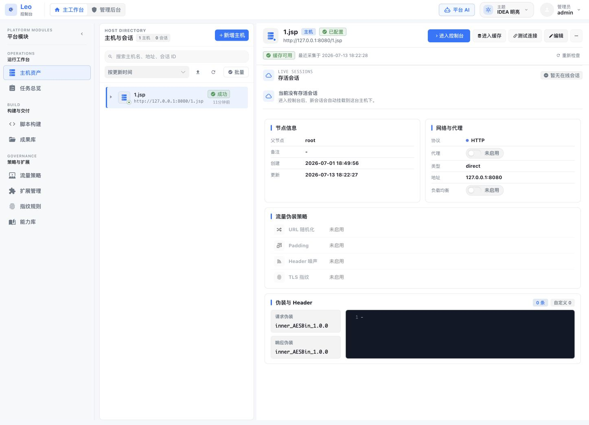
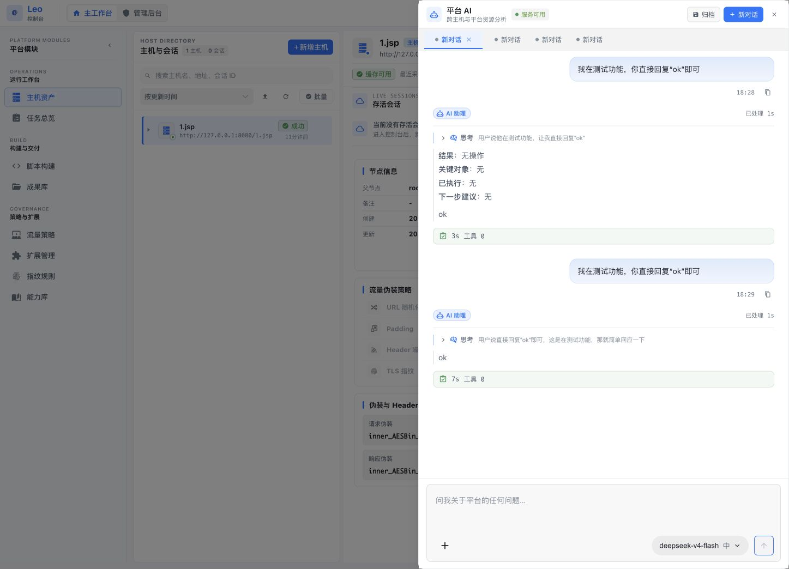
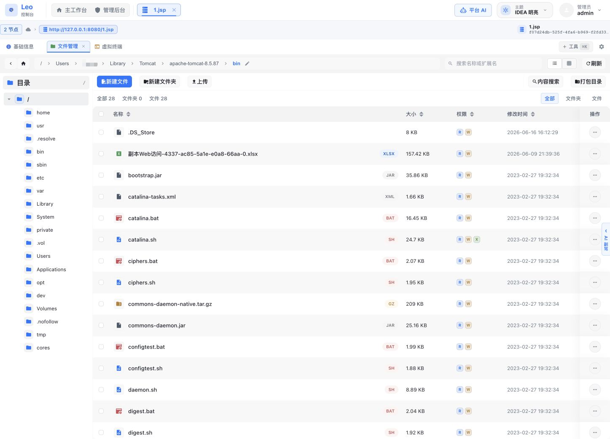
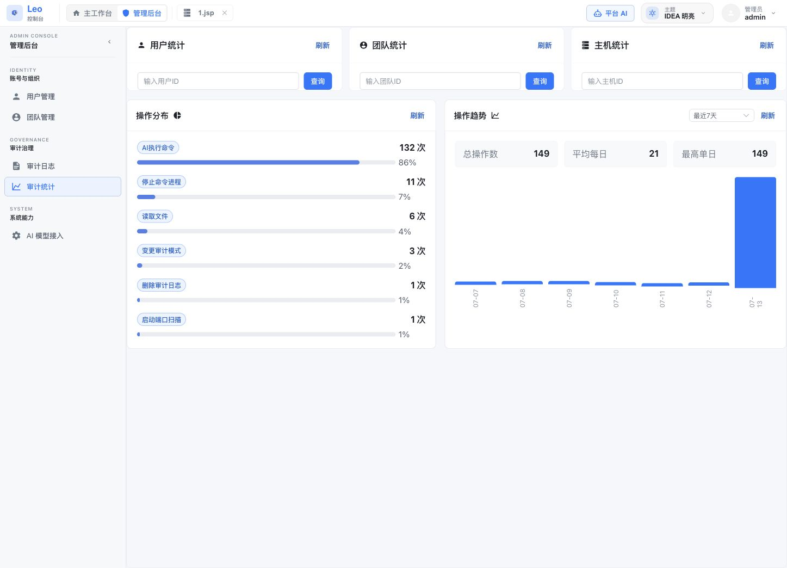
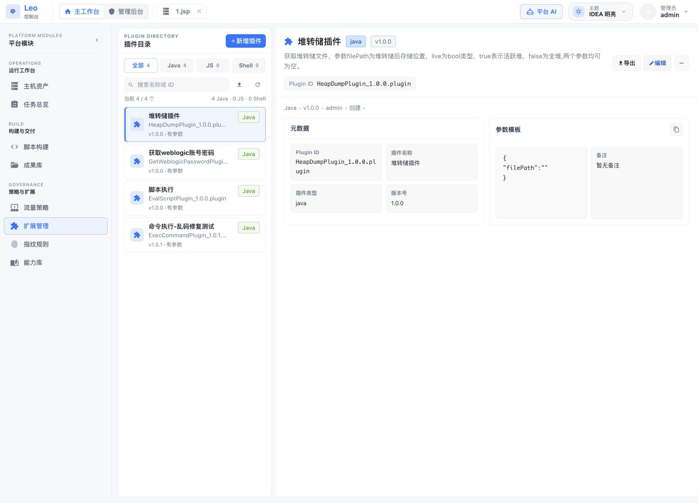
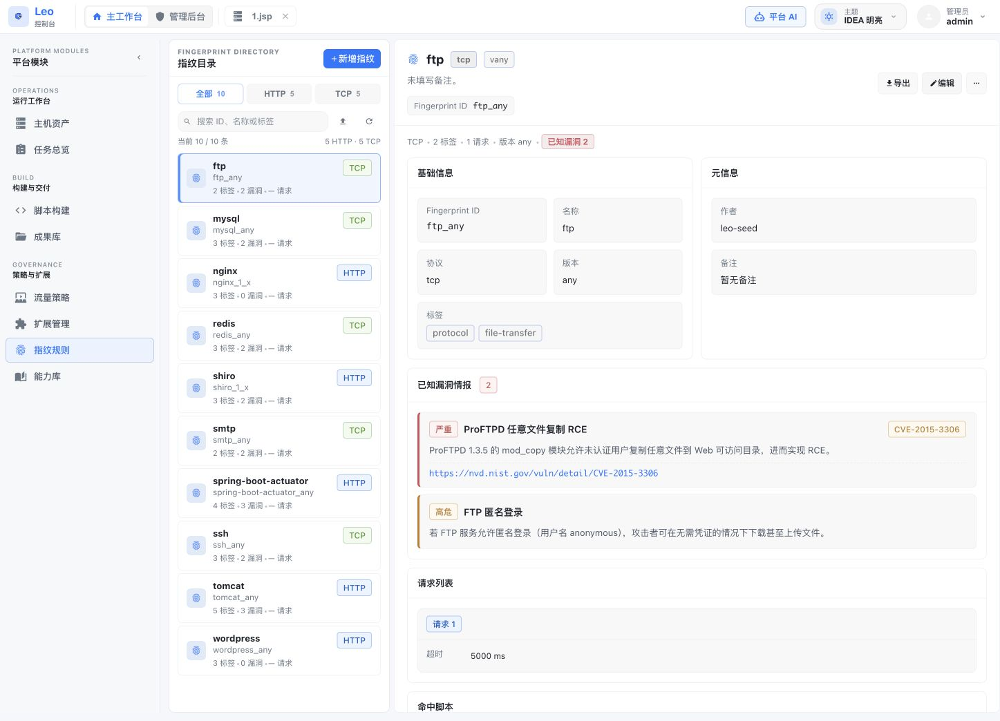

[中文](README.md) | **English**


# LeoAI

LeoAI is a web workspace for host management, project collaboration, and team administration.



*Dashboard: browse hosts, active sessions, and host details in one place.*

## Main features

- **Hosts and projects:** Organize hosts by project, view existing sessions, and manage project details and archive status.
- **AI assistant:** Start tasks and view their progress and results. Configure a model under **Admin Console → AI Model Integration** before use.
- **Team administration:** Manage users, teams, and permissions, and review audit logs in the Admin Console.

## Quick start

1. Install Java 17 or later, then download a JAR from [Releases](https://github.com/cha0upup/LeoAI/releases). If the version you need is not published, see the [contribution guide](CONTRIBUTING.md) for building from source.
2. Start the application from its working directory. Replace the example filename with the one you downloaded:

   ```bash
   java --add-opens java.base/java.lang=ALL-UNNAMED -jar LeoAi-3.0.1.jar
   ```

3. Open [http://localhost:8082](http://localhost:8082). On a fresh installation, follow the on-screen instructions to set the administrator password, then sign in as `admin`.

Alternatively, run `docker compose up -d --build` from the repository root and open the same address. Complete initial setup on a restricted network. Back up your data before upgrading from an older version, and use a fresh data directory or volume for the new deployment.

## Interface preview

These screenshots show earlier versions of the interface. Some menus and layouts may differ in the current version.

### AI assistant



*Switch conversations, select a model, and review task progress and results in one place.*

### File management



*Browse with the folder tree and breadcrumbs, filter files by type, and view file properties.*

### Admin console



*Manage users, teams, and AI models, and review audit logs and activity trends.*

### Extension management



*Browse installed extensions, review their descriptions and parameters, and manage imports and exports.*

### Fingerprint rules



*Search and filter the rule catalog, and review tags, descriptions, and related references.*

### Skill library


*Browse skills by category and see what they cover and which files they use.*

### Other pages

- **Operations console:** View the current host and switch between features using tabs.
- **Script builder:** A workspace for template options, form fields, and previews.
- **Traffic policies:** Browse the template catalog and preview requests and responses.

## Links

- [Frontend repository](https://github.com/cha0upup/LeoVueAi)
- [Contribution guide](CONTRIBUTING.md) · [Issue tracker](https://github.com/cha0upup/LeoAI/issues) · [GPL-3.0 license](LICENSE)

Use LeoAI only on systems you have permission to manage or test.
