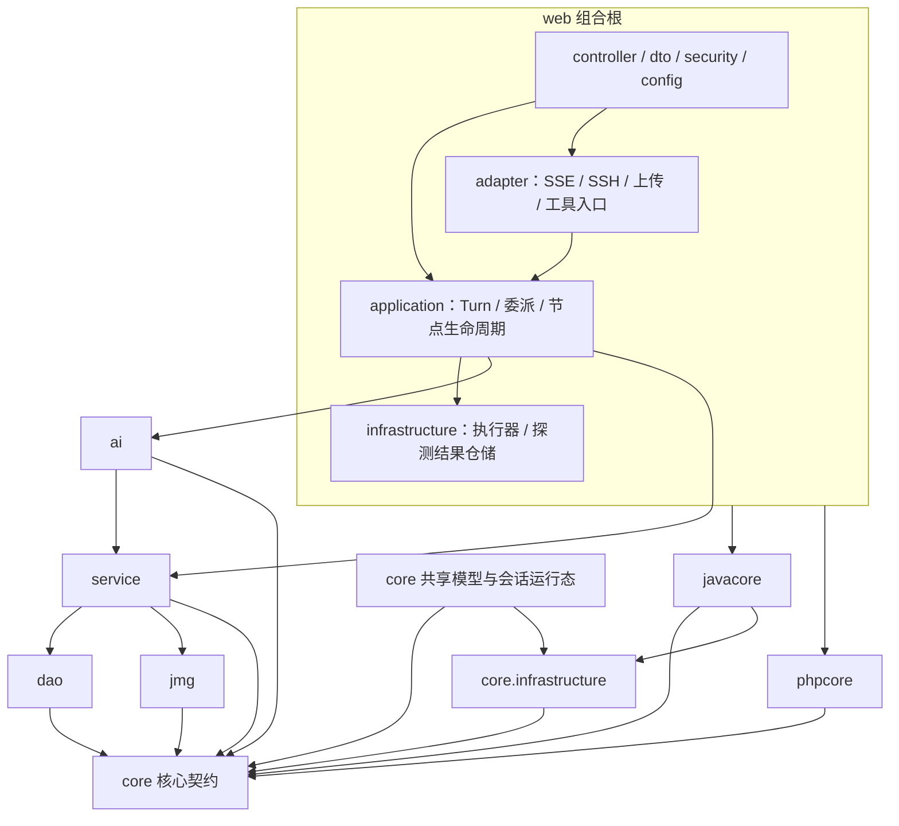

# 模块与包边界

本轮先整理包归属，保留现有 Maven 模块、HTTP/SSE 接口和 RPC Component ID。`web` 仍是组合根，应用编排暂留其中，不移入 `service`，也不新增 `application` 模块。

## web

| 包 | 职责 |
| --- | --- |
| `controller`、`dto`、`security`、`config` | HTTP 入口、请求响应、鉴权和容器装配 |
| `adapter.ai` | SSE 订阅与发送、附件输入和 AI 工具入口 |
| `adapter.ssh`、`adapter.skill` | SSH 连接实现、上传适配 |
| `application.ai` | Turn 排队与执行、租约、线程生命周期、timeline 事件和节点 AI 委派 |
| `application.agent`、`application.artifact` | 节点生命周期、会话维护、报告及用户制品用例 |
| `infrastructure.concurrent`、`infrastructure.discovery` | 有界执行器与 JDBC 探测结果存储 |

Controller 负责 HTTP Session 的读取与绑定；线程用例只接收会话标识和用户信息。应用编排不直接引用 Servlet、Spring MVC/HTTP 类型或 Controller 工具。

主 Turn 与委派 Presenter 只写运行时事件日志、整理 timeline 和处理执行收尾，不持有 `SseEmitter`。SSE 订阅独立读取持久化日志，负责发送、心跳、重连和连接关闭；后台执行不再启动一条发送目标为空的事件排空线程。工具排队事件在模型回调与执行边界同步归档，复用已持久化的事件，不重复写日志。

调度器用非阻塞执行槽位保留原有活跃 Turn 并发上限，槽位持续到异步执行完成；满载时任务留在数据库队列，由后续调度恢复。执行任务与 SSE 订阅仍使用独立的有界线程池。

平台工具绑定放在 `WebConfig` 组合根，运行时注册表只接收 `ModelRuntime → PlatformAiAgent` 创建函数，不引用具体工具适配器。应用包与适配包的反向引用由现有架构检查器统一约束。

应用结果使用对应服务内的纯数据 record，不再反向引用 HTTP DTO。初始化、缓存、摘要和报告结果直接沿用既有 JSON 字段，不增加逐字段转发包装；摘要更新与整理共用一种结果。目录查询返回纯数据条目，HTTP 目录 DTO 单独负责 `@JsonUnwrapped` 展平，保留原有平铺格式。

应用用例只抛出 `UseCaseException` 的输入无效、资源不存在、操作失败三类语义，不携带 HTTP 状态。现有全局处理器直接映射为 400、404、500，并沿用原有错误响应与日志规则；HTTP 专用状态和明细继续由适配层的 `ApiException` 表达，不逐层包装异常。

HTTP 异常只保存一份状态，数字码与响应中的 `code` 都由该状态派生。附加明细保留在响应顶层，但不覆盖固定的 `code`、`msg`，保证 HTTP 状态与主响应语义一致。

SSH 的类型化业务失败同样由全局处理器直接映射，DTO 与 Controller 不再重复转换异常。权限、认证、容量、版本冲突等状态沿用原值；主机指纹确认的 HTTP 专用明细仍使用 `ApiException`，未知连接错误继续在入口脱敏。

数据库连接配置 Controller 直接调用现有 `DatabaseConnectionProfileService`，保留登录用户、会话权限和 Agent 归属校验，不再经过转发服务。业务服务的类型化失败由全局处理器映射为原有状态与消息，业务侧鉴权继续保留。

SQL 执行失败保留原始受检异常，不转换为另一种 HTTP 异常。全局处理器统一保留 `databaseCode`、错误分类、SQLState、可重试标志及厂商码；数据库侧认证等错误继续归一为 422，避免影响应用登录态。Controller 保留原有操作审计，未知异常处理保持原逻辑。

应用包已解除对 HTTP DTO、HTTP 异常和具体适配器的引用。这仍是包级边界整理，是否拆分独立模块继续以实际需求为准。

## core 与运行时实现

| 包 | 职责 |
| --- | --- |
| `core.agent.capability`、`core.agent.database` | 共享能力和数据库输入契约 |
| `core.runtime`、`core.generator`、`core.component.runtime`、`core.rpc` | 运行时/生成器 SPI、组件交付模型和 RPC 协议 |
| `core.net` | 通信接口、异常与传输限制 |
| `core.entity`、`core.session`、`core.net.layer` 等 | 共享模型、会话运行态和协议层；其中仍有实现依赖，不视作纯契约 |
| `core.infrastructure.transport` | HTTP、转发、隧道等通信实现 |
| `core.infrastructure.persistence.session` | 文件会话缓存、快照和工作目录 |
| `core.infrastructure.bytecode` | ASM、Javassist 和反编译实现 |
| `javacore.agent`、`javacore.component` | Java 节点、服务、数据库适配和 Component 实现 |
| `phpcore` | PHP 运行时实现 |

上述核心契约包保持独立于 `core.infrastructure`；基础设施本轮仍在 `core` 模块内部，尚未实现物理模块隔离。Java 实现全部归入 `org.leo.javacore.*`，不再与共享契约共用 `org.leo.core.*` 包名。

## 依赖示意

箭头表示主要调用/依赖方向；这不是新增 Maven 模块。

## 检查与部署

- 现有 `tools/check_architecture.py` 检查模块 DAG、应用层 HTTP 边界、核心契约到基础设施的反向引用及 Java 实现命名空间；测试继续集中在现有检查器测试文件中。
- 运行 `python3 tools/test_check_architecture.py`、`python3 tools/check_architecture.py` 和 `./mvnw verify`。
- Java Component 包名变更后，通过既有 `javacore/compile-components.sh` 重编译 `.payload`，再使用 `--check` 验证 Java 6 字节码/API 及源码一致性。
- 包名是 Java 内部兼容性变更；引用旧类名的插件、脚本或缓存字节码需要重新构建。前端接口和数据库结构保持原样。
